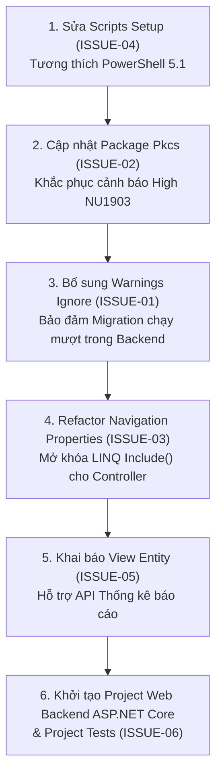

# DANH MỤC VẤN ĐỀ VÀ KHUYẾN NGHỊ KIỂM ĐỊNH (AUDIT ISSUES)

**Dự án:** Phân tích, thiết kế và xây dựng hệ thống quản lý bán vé trực tuyến tại rạp chiếu phim Beta Giải Phóng  
**Thời điểm lập:** 31/10/2026  
**Quy ước mức độ nghiêm trọng:**
- **P0 – Critical:** Lỗi làm sai nghiệp vụ, vi phạm ràng buộc ACID hoặc gây mất mát dữ liệu nghiêm trọng (Chặn hoàn toàn).
- **P1 – High:** Lỗi quan trọng ảnh hưởng trực tiếp đến quy trình chạy, deploy hoặc bảo mật hệ thống (Cần sửa trước khi chạy Backend).
- **P2 – Medium:** Hạn chế về kiến trúc hoặc tính tương thích môi trường (Cần cải thiện để tối ưu phát triển Backend).
- **P3 – Low:** Điểm cải tiến chất lượng mã nguồn hoặc mở rộng tính năng dài hạn.

---

## 1. BẢNG TỔNG HỢP DANH MỤC VẤN ĐỀ (ISSUES REGISTER)

| ID | Mức độ | Thành phần | Vấn đề | Bằng chứng kỹ thuật | Hậu quả | Cách sửa đề xuất |
|---|:---:|---|---|---|---|---|
| **ISSUE-01** | **P1** | `BetaGiaiPhong.Runner` / `Program.cs` | Lệnh `migrate` ném ngoại lệ do EF Core 10 `PendingModelChangesWarning` | Chạy lệnh `dotnet run --project .\src\BetaGiaiPhong.Runner -- migrate` trả về exit code `1`: `InvalidOperationException: An error was generated for warning 'Microsoft.EntityFrameworkCore.Migrations.PendingModelChangesWarning': The model for context 'BetaDbContext' has pending changes.` tại [Program.cs](file:///d:/Downloads/BGP_EFCore10_SQLServer_TrienKhai_FullPackage_v1_0/BetaGiaiPhong_EFCore_SQLServer_v1_0/src/BetaGiaiPhong.Runner/Program.cs#L25-L35). | Không thể áp dụng migration tự động thông qua Runner CLI hoặc script CI/CD nếu không có cờ bỏ qua cảnh báo này. | Trong `Program.cs` (và cấu hình `DbContextOptions` khi khởi tạo Backend), thêm: `.ConfigureWarnings(w => w.Ignore(RelationalEventId.PendingModelChangesWarning))` hoặc tái tạo ModelSnapshot chuẩn thông qua `dotnet ef migrations add`. |
| **ISSUE-02** | **P1** | Dependencies / `NuGet Packages` | Lỗ hổng bảo mật mức High `NU1903` trong package gián tiếp `System.Security.Cryptography.Pkcs` | Khi chạy `dotnet restore` hoặc `dotnet build`, MSBuild cảnh báo: `warning NU1903: Package 'System.Security.Cryptography.Pkcs' 9.0.11 has a known high severity vulnerability, https://github.com/advisories/GHSA-846f-f764-76mx` (tại cả project `Data` và `Runner`). | Tiềm ẩn rủi ro tấn công từ chối dịch vụ (DoS) hoặc tràn bộ đệm ASN.1 giải mã chứng chỉ nếu ứng dụng xử lý dữ liệu PKCS nhạy cảm. | Khai báo trực tiếp `<PackageReference Include="System.Security.Cryptography.Pkcs" Version="9.0.2" />` (hoặc bản vá mới nhất của Microsoft) trong `BetaGiaiPhong.Data.csproj` để ép nâng cấp package con. |
| **ISSUE-03** | **P2** | `BetaGiaiPhong.Data` / `Entities/*.cs` | Toàn bộ 17 Entity class thiếu Navigation Properties | Trong 17 tệp tại `src/BetaGiaiPhong.Data/Entities/*.cs`, các thực thể chỉ có thuộc tính vô hướng (Scalar Properties) như `showtime_id`, `room_id`, `movie_id`. Không có `public Room Room { get; set; }` hay `public ICollection<Seat> Seats { get; set; }`. Cấu hình tại [BetaModelConfiguration.cs](file:///d:/Downloads/BGP_EFCore10_SQLServer_TrienKhai_FullPackage_v1_0/BetaGiaiPhong_EFCore_SQLServer_v1_0/src/BetaGiaiPhong.Data/Persistence/BetaModelConfiguration.cs#L45) phải dùng `b.HasOne<T>().WithMany()`. | Tầng Backend ASP.NET Core không thể dùng cú pháp `.Include(o => o.OrderSeats).ThenInclude(...)` tiêu chuẩn của EF Core; lập trình viên buộc phải viết nhiều câu lệnh `.Join()` thủ công hoặc truy vấn raw SQL cồng kềnh. | Bổ sung các Navigation Properties cơ bản vào các Entity nghiệp vụ chính (`BookingOrder`, `OrderSeat`, `Showtime`, `Seat`, `ShowtimeSeat`, `Ticket`) và cập nhật cấu hình Fluent API tương ứng mà vẫn giữ nguyên tên cột và khóa ngoại. |
| **ISSUE-04** | **P2** | `scripts` / `01_prepare_dev_session.ps1` | Không tương thích với Windows PowerShell 5.1 mặc định | Tại dòng 16 và 19 của [01_prepare_dev_session.ps1](file:///d:/Downloads/BGP_EFCore10_SQLServer_TrienKhai_FullPackage_v1_0/BetaGiaiPhong_EFCore_SQLServer_v1_0/scripts/01_prepare_dev_session.ps1#L16-L19): Gọi phương thức tĩnh `[System.Security.Cryptography.RandomNumberGenerator]::GetBytes(32)`. Phương thức này chỉ có từ .NET Core / PowerShell 7+. Khi chạy trên Windows PowerShell 5.1 mặc định của Windows, báo lỗi: `MethodNotFound`. | Lập trình viên chạy script thiết lập ban đầu trên máy tính Windows thông thường sẽ bị dừng đột ngột, biến môi trường khóa bí mật không được tạo. | Sửa dòng 16 & 19 thành cú pháp tương thích mọi phiên bản PowerShell: `$bytes = New-Object byte[] 32; [System.Security.Cryptography.RandomNumberGenerator]::Create().GetBytes($bytes); $env:BGP_MOCK_HMAC_KEY_B64 = [Convert]::ToBase64String($bytes)`. |
| **ISSUE-05** | **P2** | `BetaGiaiPhong.Data` / `Persistence` | View báo cáo `vw_ShowtimeSales` chưa có Entity tương ứng trong DbContext | Migration `202610310002_ReportView.cs` tạo view `dbo.vw_ShowtimeSales`, nhưng trong [BetaDbContext.cs](file:///d:/Downloads/BGP_EFCore10_SQLServer_TrienKhai_FullPackage_v1_0/BetaGiaiPhong_EFCore_SQLServer_v1_0/src/BetaGiaiPhong.Data/Persistence/BetaDbContext.cs#L8-L25) không có `DbSet<ShowtimeSalesDto>` hay cấu hình `b.ToView("vw_ShowtimeSales")`. | Backend không thể truy vấn view báo cáo doanh thu trực tiếp qua LINQ (`_context.ShowtimeSales.Where(...)`), buộc phải gọi `Database.SqlQueryRaw` hoặc `FromSqlInterpolated`. | Tạo lớp `ShowtimeSalesSummary` (hoặc Dto tương ứng), khai báo `public DbSet<ShowtimeSalesSummary> ShowtimeSales => Set<ShowtimeSalesSummary>();` và cấu hình `modelBuilder.Entity<ShowtimeSalesSummary>(b => { b.HasNoKey(); b.ToView("vw_ShowtimeSales"); });`. |
| **ISSUE-06** | **P3** | `BetaGiaiPhong.slnx` / `Test Architecture` | Dự án chưa có Project Unit Test / Integration Test độc lập (`xUnit`) | Hiện tại các kịch bản kiểm thử (`smoke`, `race`, `late`, `verify`) được viết gom trong console app `BetaGiaiPhong.Runner`. Solution chưa có project kiểm thử chuẩn (`BetaGiaiPhong.Tests`). | Không chạy được lệnh `dotnet test` trong quy trình CI/CD chuẩn; khó viết test tự động cho các tầng Controller, Service và DTO của Backend sau này. | Tạo project `tests/BetaGiaiPhong.Tests/BetaGiaiPhong.Tests.csproj` sử dụng xUnit + FluentAssertions + WebApplicationFactory để kiểm thử tự động toàn diện. |
| **ISSUE-07** | **P3** | `BetaGiaiPhong.Data` / `QrTokenProtector.cs` | Cơ chế mã hóa QR Token chưa hỗ trợ xoay vòng khóa (Key Rotation) | Tại dòng 9 của [QrTokenProtector.cs](file:///d:/Downloads/BGP_EFCore10_SQLServer_TrienKhai_FullPackage_v1_0/BetaGiaiPhong_EFCore_SQLServer_v1_0/src/BetaGiaiPhong.Data/Services/QrTokenProtector.cs#L9), `KeyId` được gán cứng là `"prototype-v1"`. Khóa AES được đọc từ biến môi trường duy nhất. | Khi cần đổi khóa bảo mật định kỳ, các vé đã phát hành bằng khóa cũ sẽ không thể giải mã (`Unseal`) được nữa nếu không có bảng lưu trữ lịch sử khóa. | Thiết kế `KeyVault` hoặc bảng cấu hình danh sách khóa bí mật hỗ trợ nhiều `KeyId` (giải mã theo `qr_key_id` lưu trên vé). |
| **ISSUE-08** | **P3** | `BetaGiaiPhong.Data` / `SqlServerLocks.cs` | Khóa hàng toàn bộ suất chiếu (`UPDLOCK, HOLDLOCK`) có thể tạo nghẽn cổ chai khi tải cực cao | Tại [SqlServerLocks.cs](file:///d:/Downloads/BGP_EFCore10_SQLServer_TrienKhai_FullPackage_v1_0/BetaGiaiPhong_EFCore_SQLServer_v1_0/src/BetaGiaiPhong.Data/Services/Shared.cs#L54-L57), mọi thao tác đặt ghế, hủy đơn, thanh toán đều khóa hàng `Showtimes` theo cấp độ `Serializable`. | Hoàn toàn an toàn tuyệt đối cho rạp đơn (single-cinema) và đạt chuẩn kiểm định nguyên mẫu, nhưng với hệ thống quy mô lớn hàng trăm phòng chiếu đồng thời, việc khóa cả suất chiếu sẽ làm giảm thông lượng (throughput) khi hàng nghìn khách đặt các ghế khác nhau trong cùng 1 suất. | Ở các giai đoạn mở rộng sản xuất (Post-MVP), chuyển dần sang kỹ thuật cập nhật có điều kiện theo từng ghế (`Optimistic Concurrency with RowVersion` hoặc conditional update `UPDATE ShowtimeSeats SET state='HELD' WHERE state='AVAILABLE'`) kèm cơ chế retry. |

---

## 2. KẾ HOẠCH HÀNH ĐỘNG VÀ THỨ TỰ ƯU TIÊN KHẮC PHỤC

Để chuẩn bị môi trường kỹ thuật hoàn hảo trước khi bước vào phát triển Backend ASP.NET Core MVC/API, các vấn đề cần được xử lý theo trình tự phụ thuộc kỹ thuật sau:

---

## 3. ĐÁNH GIÁ TỔNG QUAN RỦI RO
- **Rủi ro rò rỉ dữ liệu / Sai lệch giao dịch:** **RẤT THẤP** (Đã kiểm chứng thực tế qua 50 request cạnh tranh và 5 truy vấn kiểm tra toàn vẹn CSDL).
- **Rủi ro gián đoạn triển khai Backend:** **TRUNG BÌNH** (Chỉ xoay quanh các vấn đề cấu hình cảnh báo EF Core và thiếu Navigation Properties, hoàn toàn có thể khắc phục nhanh chóng trong giai đoạn khởi tạo Backend).
