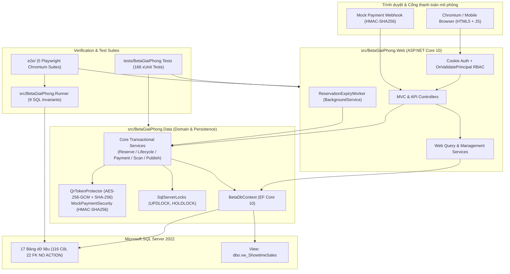
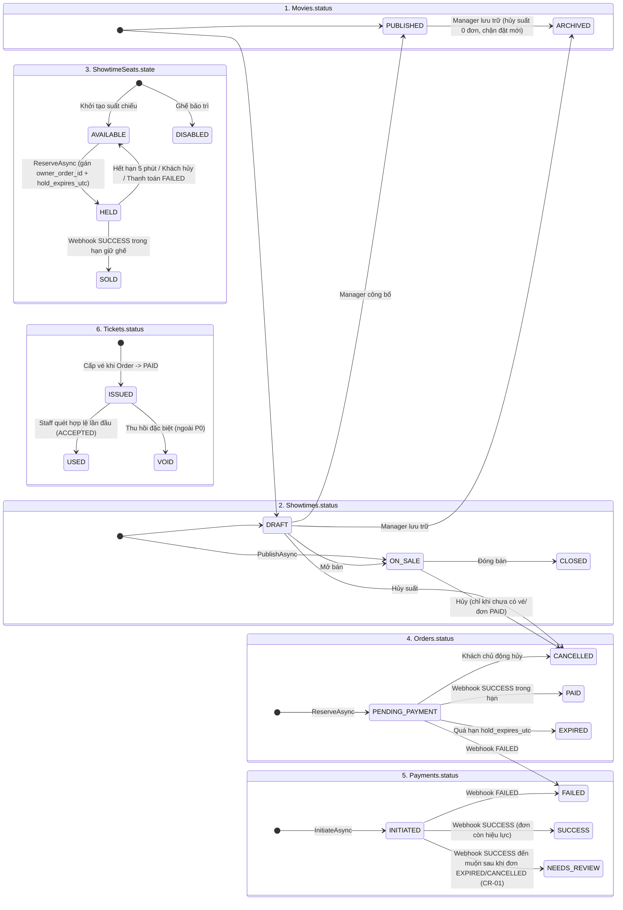

# KIẾN TRÚC HỆ THỐNG, CƠ CHẾ ĐỒNG THỜI VÀ MÔ HÌNH DỮ LIỆU (`ARCHITECTURE_AND_DATA_MODEL`)

**Đề tài:** Phân tích, thiết kế và xây dựng hệ thống quản lý bán vé trực tuyến tại rạp chiếu phim Beta Giải Phóng  
**Tác giả:** Vũ Văn Khiêm (`11235581`) — Ngành Hệ thống thông tin quản lý (MIS)  
**Giảng viên hướng dẫn:** ThS. Nguyễn Anh Phương  
**Phiên bản:** 1.0 (BE-05C Final Delivery)

---

## 1. Kiến trúc tổng thể (Modular Monolith trên .NET 10)

Hệ thống được thiết kế theo kiến trúc **Modular Monolith** trên nền tảng **.NET 10 (ASP.NET Core MVC + RESTful Web API)** kết hợp **Entity Framework Core 10** và **Microsoft SQL Server 2022**. Kiến trúc phân tách nghiêm ngặt giữa tầng dữ liệu/nghiệp vụ cốt lõi (`BetaGiaiPhong.Data`), tầng giao diện web/API (`BetaGiaiPhong.Web`), công cụ kiểm định bất biến độc lập (`BetaGiaiPhong.Runner`) và hai tầng kiểm thử tự động (`BetaGiaiPhong.Tests`, `e2e/`).

### 1.1. Cấu trúc các dự án trong Solution (`BetaGiaiPhong.slnx`)

| Dự án / Thư mục | Loại dự án | Trách nhiệm kiến trúc |
|---|---|---|
| `src/BetaGiaiPhong.Data` | Class Library (`net10.0`) | Chứa 17 thực thể (`Entities`), cấu hình Fluent API (`Persistence/Configurations`), `BetaDbContext`, 2 EF Core Migrations, `DemoSeeder`, các dịch vụ miền giao dịch (`SeatReservationService`, `OrderLifecycleService`, `PaymentService`, `TicketScanningService`, `ShowtimePublishingService`), khóa bi quan SQL Server (`SqlServerLocks`), bảo mật mật mã (`QrTokenProtector`, `MockPaymentSecurity`, `PasswordHashing`) và kiểm toán (`Auditing`, `SecurityRules`). |
| `src/BetaGiaiPhong.Web` | ASP.NET Core Web App (`net10.0`) | Cung cấp giao diện Razor Views (Customer, Staff, Manager), các REST API Controllers, dịch vụ truy vấn (`CatalogQueryService`, `ShowtimeSeatMapQueryService`, `OrderQueryService`, `TicketQueryService`, `ManagementQueryService`, `MovieManagementService`), xác thực Cookie RBAC (`AuthService`, `OnValidatePrincipal`) và tiến trình nền thu hồi ghế quá hạn (`ReservationExpiryWorker`). |
| `src/BetaGiaiPhong.Runner` | Console CLI (`net10.0`) | Công cụ dòng lệnh phục vụ khởi tạo CSDL (`migrate-seed`), chạy mô phỏng kịch bản kiểm định và kiểm tra **9 nhóm bất biến toàn vẹn SQL Server** (`verify`), đồng thời hỗ trợ quản lý vòng đời DB E2E (`create-e2e-db`, `drop-e2e-db`, `check-db-exists`, `get-order-ciphers`, `corrupt-e2e-db`). |
| `tests/BetaGiaiPhong.Tests` | xUnit Test Project (`net10.0`) | Bộ kiểm thử tự động **166 ca kiểm thử** gồm Unit Tests, SQL Server Integration Tests (với `TestDatabaseFixture` cô lập DB theo GUID), Concurrency Tests và `WebApplicationFactory` Functional/Security Tests. |
| `e2e/` | Playwright TypeScript (`@playwright/test`) | Bộ kiểm thử trình duyệt thực **Playwright Chromium (5 bộ spec)** kiểm tra toàn trình `Manager -> Customer -> Staff -> Manager`, bảo mật/nhập liệu âm tính, phục hồi sau khởi động lại, tải đồng thời và cổng chất lượng teardown. |

### 1.2. Sơ đồ phụ thuộc (Dependency Graph)

---

## 2. Xác thực, Phân quyền (RBAC) và Thu hồi phiên tức thời

1. **Băm mật khẩu (`PasswordHasherService` / `PasswordHashing`):**
   - Sử dụng thuật toán `PBKDF2-SHA256` (`Rfc2898DeriveBytes`) với `100.000` vòng lặp, salt ngẫu nhiên `16 byte` (`128-bit`) từ `RandomNumberGenerator`, đầu ra `32 byte` (`256-bit`).
   - Định dạng lưu trữ trong `Users.password_hash`: `PBKDF2$100000$<base64-salt>$<base64-subkey>`.
   - So sánh mật khẩu bằng `CryptographicOperations.FixedTimeEquals` để chống tấn công kênh kề thời gian (timing attack).
2. **Cookie Authentication & RBAC Policies (`Program.cs`):**
   - Cookie tên `BetaGiaiPhong.Auth`, cờ `HttpOnly = true`, `SameSite = Lax`, thời hạn trượt `8 giờ`.
   - Với các đường dẫn `/api/*`, sự kiện `OnRedirectToLogin` trả mã `401 Unauthorized` và `OnRedirectToAccessDenied` trả mã `403 Forbidden` (JSON) thay vì chuyển hướng HTML.
   - Các chính sách phân quyền (`AuthorizationPolicy`):
     - `RequireCustomer`: Yêu cầu một trong các vai trò `CUSTOMER`, `STAFF`, `MANAGER`, `ADMIN`.
     - `RequireStaffOrHigher`: Yêu cầu `STAFF`, `MANAGER`, hoặc `ADMIN`.
     - `RequireManagerOrHigher`: Yêu cầu `MANAGER` hoặc `ADMIN`.
     - `RequireAdmin`: Yêu cầu `ADMIN`.
3. **Thu hồi quyền tức thời ở Request kế tiếp (`OnValidatePrincipal`):**
   - Trong `Program.cs`, sự kiện `CookieAuthenticationEvents.OnValidatePrincipal` truy vấn trực tiếp bảng `Users` và `UserRoles` trên mỗi HTTP request có xác thực.
   - Nếu tài khoản bị chuyển sang `DISABLED` hoặc không còn vai trò hợp lệ, hệ thống gọi `context.RejectPrincipal()` và `SignOutAsync()` ngay lập tức, vô hiệu hóa cookie hiện hành mà không chờ hết hạn cookie (`Test 3.2`).

---

## 3. Danh mục đầy đủ các Route MVC & REST API

| Nhóm | Phương thức & Đường dẫn (Route) | Controller & Action | Chính sách phân quyền | Chức năng chính |
|---|---|---|---|---|
| **Health** | `GET /health` | `Program.cs` (Minimal API) | Công khai (`AllowAnonymous`) | Kiểm tra trạng thái sống của Web + kết nối SQL Server. |
| **Auth** | `GET /account/login` | `AccountController.Login` | Công khai | Hiển thị trang đăng nhập. |
| **Auth** | `POST /account/login` | `AccountController.LoginPost` | Công khai + Anti-CSRF | Xác thực email/mật khẩu, cấp cookie `BetaGiaiPhong.Auth`. |
| **Auth** | `POST /account/logout` | `AccountController.Logout` | Đã đăng nhập + Anti-CSRF | Đăng xuất và xóa cookie phiên. |
| **Auth** | `GET /account/access-denied` | `AccountController.AccessDenied` | Công khai | Hiển thị trang từ chối truy cập (`403`). |
| **Auth** | `GET /account/profile` | `AccountController.Profile` | Đã đăng nhập | Hiển thị thông tin tài khoản và vai trò hiện tại. |
| **Auth API** | `GET /api/auth/me` | `AccountController.Me` | Đã đăng nhập | Trả JSON thông tin người dùng và danh sách vai trò. |
| **Catalog** | `GET /` | `CatalogController.Index` | Công khai | Trang chủ tra cứu phim `PUBLISHED` và lịch chiếu `ON_SALE`. |
| **Catalog** | `GET /movies/{id:long}` | `CatalogController.Details` | Công khai | Chi tiết phim và các suất chiếu đang mở bán. |
| **Catalog API**| `GET /api/catalog/movies` | `CatalogController.GetMovies` | Công khai | API lọc phim theo từ khóa, thể loại, độ tuổi, ngày chiếu. |
| **Seat Map** | `GET /showtimes/{id:long}` | `ShowtimesController.Details` | Công khai | Giao diện chọn ghế trực quan theo suất chiếu. |
| **Seat Map API**| `GET /api/showtimes/{id:long}/seat-map` | `ShowtimesController.GetSeatMap` | Công khai | API trả trạng thái ghế (`AVAILABLE`, `HELD`, `SOLD`, `DISABLED`) và bảng giá. |
| **Booking** | `POST /bookings/reserve` | `BookingsController.ReserveForm` | `RequireCustomer` + Anti-CSRF | Nhận form chọn ghế (1–8 ghế), giữ ghế nguyên tử và chuyển tới trang đơn hàng. |
| **Booking API**| `POST /api/bookings/reserve` | `BookingsController.ReserveApi` | `RequireCustomer` | API giữ ghế nguyên tử, trả `201 Created` hoặc `409 Conflict` kèm mã ghế xung đột. |
| **Orders** | `GET /orders` | `OrdersController.Index` | `RequireCustomer` | Danh sách lịch sử đơn hàng của khách hàng hiện tại. |
| **Orders** | `GET /orders/{id:long}` | `OrdersController.Details` | `RequireCustomer` (Chủ đơn) | Chi tiết đơn hàng, đồng hồ đếm ngược giữ ghế và danh sách vé QR (nếu `PAID`). |
| **Orders** | `POST /orders/{id:long}/cancel` | `OrdersController.CancelForm` | `RequireCustomer` + Anti-CSRF | Khách hàng hủy đơn `PENDING_PAYMENT` và giải phóng ghế `HELD`. |
| **Orders** | `GET /orders/{id:long}/tickets/{ticketId:long}/qr.png` | `OrdersController.GetTicketQrPng` | `RequireCustomer` (Chủ đơn) | Giải mã `qr_token_cipher` trong bộ nhớ và trả ảnh PNG mã QR (`246x246` px). |
| **Orders API** | `GET /api/orders` | `OrdersController.GetMyOrdersApi` | `RequireCustomer` | API trả danh sách đơn của khách hàng hiện tại. |
| **Orders API** | `GET /api/orders/{id:long}` | `OrdersController.GetOrderDetailsApi`| `RequireCustomer` (Chủ đơn) | API trả chi tiết đơn hàng (không lộ `qr_token` thô). |
| **Orders API** | `POST /api/orders/{id:long}/cancel`| `OrdersController.CancelOrderApi` | `RequireCustomer` (Chủ đơn) | API hủy đơn đang chờ thanh toán. |
| **Payment** | `POST /orders/{orderId:long}/payments/initiate` | `PaymentsController.InitiateForm` | `RequireCustomer` + Anti-CSRF | Khởi tạo lượt thanh toán mô phỏng (`Payments.INITIATED`). |
| **Payment** | `POST /orders/{orderId:long}/payments/simulate` | `PaymentsController.SimulateCallbackForm`| `RequireCustomer` + Anti-CSRF | Nút mô phỏng kết quả thanh toán trên UI (chỉ bật khi `EnableSimulatorUi=true`). |
| **Payment API**| `POST /api/orders/{orderId:long}/payments/mock-attempt` | `PaymentsController.InitiateMockAttempt` | `RequireCustomer` (Chủ đơn) | API khởi tạo lượt thanh toán, trả `PaymentId`, `AttemptKey`, `TransactionRef`. |
| **Webhook API**| `POST /api/webhooks/mock-payment` | `PaymentsController.ReceiveMockWebhook` | Xác thực chữ ký `X-Mock-Signature` (`HMAC-SHA256`) | Tiếp nhận callback bất đồng bộ từ Mock Gateway, xử lý lũy đẳng `PAID`/`FAILED`/`NEEDS_REVIEW`. |
| **Staff UI** | `GET /staff/check-in` | `StaffCheckInController.Index` | `RequireStaffOrHigher` | Giao diện quầy soát vé QR (Camera, tải ảnh PNG, nhập mã thủ công). |
| **Staff UI** | `POST /staff/check-in` | `StaffCheckInController.ScanForm` | `RequireStaffOrHigher` + Anti-CSRF| Xử lý soát vé qua form MVC. |
| **Staff UI** | `GET /staff/check-in/history` | `StaffCheckInController.History` | `RequireStaffOrHigher` | Xem lịch sử các lượt quét vé (`TicketScans` & `AuditLogs`). |
| **Staff API** | `POST /api/staff/tickets/scan` | `StaffTicketsController.Scan` | `RequireStaffOrHigher` | API soát vé nguyên tử, trả `ACCEPTED`, `ALREADY_USED`, `WRONG_SHOWTIME`, `OUTSIDE_WINDOW`, `NOT_FOUND`. |
| **Manager UI** | `GET /management` (hoặc `/management/dashboard`) | `ManagementController.Dashboard` | `RequireManagerOrHigher` | Bảng điều khiển tổng quan vận hành rạp (doanh thu, vé bán, suất chiếu). |
| **Manager UI** | `GET /management/movies` | `ManagementController.Movies` | `RequireManagerOrHigher` | Danh sách toàn bộ phim (`DRAFT`, `PUBLISHED`, `ARCHIVED`). |
| **Manager UI** | `GET/POST /management/movies/create`| `ManagementController.CreateMovie` | `RequireManagerOrHigher` | Tạo phim mới. |
| **Manager UI** | `GET/POST /management/movies/{id:long}/edit` | `ManagementController.EditMovie` | `RequireManagerOrHigher` | Cập nhật thông tin và trạng thái phim. |
| **Manager UI** | `POST /management/movies/{id:long}/archive` | `ManagementController.ArchiveMovieForm`| `RequireManagerOrHigher` | Lưu trữ phim (`ARCHIVED`) và tự động hủy các suất chiếu chưa phát sinh đơn. |
| **Manager UI** | `GET /management/rooms` & `/management/rooms/{id:long}` | `ManagementController.Rooms` / `RoomDetails` | `RequireManagerOrHigher` | Xem danh sách phòng chiếu và ma trận sơ đồ ghế vật lý. |
| **Manager UI** | `GET /management/showtimes` | `ManagementController.Showtimes` | `RequireManagerOrHigher` | Danh sách suất chiếu kèm trạng thái và chỉ số lấp đầy. |
| **Manager UI** | `GET/POST /management/showtimes/create` | `ManagementController.CreateShowtime`| `RequireManagerOrHigher` | Tạo, cấu hình giá vé (`STANDARD`, `VIP`, `COUPLE`) và mở bán suất chiếu mới. |
| **Manager UI** | `POST /management/showtimes/{id:long}/status` | `ManagementController.UpdateShowtimeStatusForm` | `RequireManagerOrHigher` | Đóng bán (`CLOSED`) hoặc hủy (`CANCELLED`) suất chiếu chưa có vé bán. |
| **Manager UI** | `GET /management/reports` | `ManagementController.Reports` | `RequireManagerOrHigher` | Báo cáo doanh thu và tỷ lệ lấp đầy lọc theo ngày, phim, phòng chiếu. |
| **Manager API**| `GET/POST/PUT /api/management/movies...` | `ManagementController` | `RequireManagerOrHigher` | Các REST API quản lý danh mục phim. |
| **Manager API**| `GET /api/management/rooms` | `ManagementController.GetRoomsApi` | `RequireManagerOrHigher` | API danh sách phòng chiếu và sức chứa. |
| **Manager API**| `GET/POST /api/management/showtimes...` | `ManagementController` | `RequireManagerOrHigher` | Các REST API tạo và đổi trạng thái suất chiếu. |
| **Manager API**| `GET /api/management/reports/sales` | `ManagementController.GetSalesReportApi` | `RequireManagerOrHigher` | API truy vấn báo cáo doanh thu từ `dbo.vw_ShowtimeSales`. |

---

## 4. Ranh giới Giao dịch (Transaction Boundaries) và Phân cấp Khóa SQL Server (Locking Hierarchy)

Để triệt tiêu hoàn toàn hiện tượng bán trùng ghế (double-booking), tạo trùng lịch chiếu (overlapping showtimes), phát hành vé lặp (duplicate ticket issuance) và quét vé hai lần (double check-in), hệ thống kết hợp mức cô lập `IsolationLevel.Serializable` với khóa bi quan tường minh `WITH (UPDLOCK, HOLDLOCK)` tại `src/BetaGiaiPhong.Data/Services/Shared.cs` (`SqlServerLocks`):

| Nghiệp vụ | Dịch vụ thực thi | Mức cô lập | Thứ tự khóa tài nguyên (`UPDLOCK, HOLDLOCK`) | Bảo vệ bất biến |
|---|---|---|---|---|
| **Công bố suất chiếu & chống trùng lịch** | `ShowtimePublishingService.PublishAsync` | `Serializable` | `1. Movies (movie_id)` $\rightarrow$ `2. Rooms (room_id)` | Tuân thủ đúng thứ tự khóa `Movie -> Room` (`CR-07`) để chống Deadlock khi 2 Manager cùng xếp lịch. Ngăn chặn tuyệt đối 2 suất chiếu chồng lấn thời gian (tính cả `buffer_minutes`) trong cùng phòng chiếu. |
| **Giữ ghế tạm thời (1–8 ghế)** | `SeatReservationService.ReserveAsync` | `Serializable` | `1. Showtimes (showtime_id)` $\rightarrow$ `2. ShowtimeSeats` | Tuần tự hóa mọi yêu cầu đặt ghế trên cùng một `showtime_id`. Trước khi kiểm tra trạng thái ghế, tự động thu hồi các đơn quá hạn của suất đó, kiểm tra `Movie.Status == PUBLISHED` và `Showtime.Status == ON_SALE`. Nếu $\ge 1$ ghế không `AVAILABLE`, rollback toàn bộ. |
| **Hủy đơn / Quét hết hạn giữ ghế** | `OrderLifecycleService.CancelAsync` / `ExpireDueOrdersAsync` | `Serializable` | `1. Showtimes (showtime_id)` $\rightarrow$ `2. Orders & ShowtimeSeats` | Chỉ giải phóng những dòng `ShowtimeSeats` đang ở trạng thái `HELD` và có `owner_order_id == order.OrderId`. |
| **Xử lý Webhook thanh toán & Cấp vé QR** | `PaymentService.ApplyVerifiedMockAsync` | `Serializable` | `1. Showtimes (showtime_id)` $\rightarrow$ `2. Orders & Payments` | Khóa suất chiếu trước khi kiểm tra trạng thái đơn và hạn giữ ghế. Nếu hợp lệ: chuyển `Orders -> PAID`, `ShowtimeSeats -> SOLD`, sinh `Tickets` nguyên tử. Nếu đến muộn sau khi đơn `EXPIRED`: giữ `Orders.EXPIRED`, ghi `Payments.NEEDS_REVIEW` (`CR-01`). |
| **Soát vé QR tại cổng kiểm soát** | `TicketScanningService.ScanAsync` | `Serializable` | `1. Tickets (WHERE qr_token_hash = @p0 WITH (UPDLOCK, HOLDLOCK))` | Khóa trực tiếp dòng vé theo băm `SHA-256` trước khi đọc `Tickets.status`. Đảm bảo khi có 2 yêu cầu quét đồng thời trên cùng 1 mã QR, đúng 1 luồng nhận `ACCEPTED` (`ISSUED -> USED`) và luồng thứ hai nhận `ALREADY_USED`. |

---

## 5. Mô hình Máy trạng thái (State Machines) của 6 Thực thể Cốt lõi

---

## 6. Bảo mật Mật mã cho Webhook và Vé điện tử QR

### 6.1. Xác thực chữ ký Webhook & Tính lũy đẳng (`MockPaymentSecurity`)
- Mỗi thông báo callback gửi đến `POST /api/webhooks/mock-payment` phải đính kèm chữ ký `HMAC-SHA256` trên chuỗi chuẩn hóa:
  $$\text{CanonicalPayload} = \text{provider} \mathbin{\Vert} \text{"|"} \mathbin{\Vert} \text{eventRef} \mathbin{\Vert} \text{"|"} \mathbin{\Vert} \text{txRef} \mathbin{\Vert} \text{"|"} \text{orderCode} \mathbin{\Vert} \text{"|"} \text{amountVnd} \mathbin{\Vert} \text{"|"} \text{outcome}$$
- Chữ ký được kiểm tra bằng `CryptographicOperations.FixedTimeEquals`. Nếu sai chữ ký, hệ thống ghi nhận sự kiện từ chối và trả mã `401 Unauthorized`.
- Tính lũy đẳng (`Idempotency`) được bảo vệ ở 2 lớp:
  1. Chỉ mục duy nhất `UX_PaymentEvents_Provider_EventRef` trên `(provider, provider_event_ref)`.
  2. Kiểm tra trạng thái trong `PaymentService.ApplyVerifiedMockAsync`: nếu sự kiện đã xử lý hoặc đơn đã `PAID` và cùng kết quả `SUCCESS`, trả về `DUPLICATE` (`200 OK`) mà không tạo thêm vé.

### 6.2. Mật mã hóa Token QR (`QrTokenProtector` — `CR-06`)
- **Sinh token:** Sử dụng bộ sinh số ngẫu nhiên mật mã `RandomNumberGenerator.GetBytes(32)` (`256-bit` entropy), mã hóa thành chuỗi Base64URL dài đúng **43 ký tự** (`/^[A-Za-z0-9_-]{43}$/`).
- **Lưu trữ không lộ văn bản rõ (Zero Plaintext Storage):**
  - Cột `Tickets.qr_token_hash` (`binary(32)`, Unique Key `UQ_Tickets_04`): lưu giá trị băm một chiều `SHA256(UTF8(rawToken))` phục vụ tra cứu nhanh và khóa dòng khi nhân viên quét vé.
  - Cột `Tickets.qr_token_cipher` (`varbinary(max)`): lưu cấu trúc `nonce (12B) || tag (16B) || ciphertext` được mã hóa đối xứng có xác thực bằng **`AES-256-GCM`** với khóa 32 byte nạp từ cấu hình ngoài CSDL (`QrSecurity:AesKeyBase64` / `BGP_QR_AES_KEY`).
- **Hiển thị và Quét mã QR:**
  - Khi khách hàng mở trang đơn hàng `PAID`, `TicketQueryService` giải mã `qr_token_cipher` trong bộ nhớ RAM chỉ để kết xuất luồng byte ảnh PNG `QRCoder` (`qrCode.GetGraphic(6)` kích thước `246x246` px, tối ưu hóa kích thước module `6px < 8px` block size của bộ giải mã `ZXing HybridBinarizer`).
  - Chuỗi `qr_token` 43 ký tự tuyệt đối không bao giờ được nhúng vào HTML DOM, thuộc tính `data-*`, JSON API hay console log (`E2E Phase 0.4`).

---

## 7. Mô hình Dữ liệu Quan hệ SQL Server (17 Bảng, 116 Cột, 22 Khóa ngoại, 1 View)

### 7.1. Tổng hợp 17 Bảng dữ liệu (`docs/Data_Dictionary_116_Columns.csv`)

| STT | Tên bảng | Phân nhóm miền | Số cột | Khóa chính (PK) | Khóa duy nhất / Chỉ mục đặc biệt (UQ / UX) |
|:---:|---|---|:---:|---|---|
| 1 | `Users` | Phân quyền & Kiểm toán | 7 | `user_id` (`bigint IDENTITY`) | `UQ_Users_01 (email)`, `UQ_Users_02 (normalized_email)` |
| 2 | `Roles` | Phân quyền & Kiểm toán | 3 | `role_id` (`int IDENTITY`) | `UQ_Roles_01 (role_code)` |
| 3 | `UserRoles` | Phân quyền & Kiểm toán | 3 | `(user_id, role_id)` | — |
| 4 | `AuditLogs` | Phân quyền & Kiểm toán | 8 | `audit_id` (`bigint IDENTITY`) | `IX_AuditLogs_Entity`, `CK_AuditLogs_01 (ISJSON)` |
| 5 | `Movies` | Danh mục & Lịch chiếu | 8 | `movie_id` (`bigint IDENTITY`) | `CK_Movies_01 (duration_min BETWEEN 30 AND 300)` |
| 6 | `Rooms` | Danh mục & Lịch chiếu | 5 | `room_id` (`int IDENTITY`) | `UQ_Rooms_01 (room_code)` |
| 7 | `SeatTypes` | Danh mục & Lịch chiếu | 4 | `seat_type_code` (`varchar(16)`) | `STANDARD`, `VIP`, `COUPLE` |
| 8 | `Seats` | Danh mục & Lịch chiếu | 7 | `seat_id` (`bigint IDENTITY`) | `UQ_Seats_01 (room_id, seat_code)`, `UQ_Seats_02 (room_id, row_label, column_no)`, `AK_Seats_Seat_Room (seat_id, room_id)` |
| 9 | `Showtimes` | Danh mục & Lịch chiếu | 11 | `showtime_id` (`bigint IDENTITY`) | `AK_Showtimes_Showtime_Room (showtime_id, room_id)`, `IX_Showtimes_Room_StartUtc` |
| 10 | `SeatPrices` | Danh mục & Lịch chiếu | 4 | `(showtime_id, seat_type_code)` | `CK_SeatPrices_01 (amount_vnd > 0)` |
| 11 | `Orders` | Đặt ghế & Thanh toán | 15 | `order_id` (`bigint IDENTITY`) | `UQ_Orders_01 (order_code)`, `AK_Orders_Order_Showtime (order_id, showtime_id)` |
| 12 | `ShowtimeSeats`| Đặt ghế & Thanh toán | 7 | `(showtime_id, seat_id)` | `CK_ShowtimeSeats_02` (ràng buộc `HELD`/`SOLD` với `owner_order_id`), `row_ver` (`rowversion`) |
| 13 | `OrderSeats` | Đặt ghế & Thanh toán | 5 | `(order_id, seat_id)` | `UQ_OrderSeats_01 (order_id, showtime_id, seat_id)` |
| 14 | `Payments` | Đặt ghế & Thanh toán | 9 | `payment_id` (`bigint IDENTITY`) | `UQ_Payments_02 (order_id, attempt_key)`, `UQ_Payments_03 (provider, provider_transaction_ref)` |
| 15 | `PaymentEvents`| Đặt ghế & Thanh toán | 8 | `payment_event_id` (`bigint IDENTITY`) | `UX_PaymentEvents_Provider_EventRef (provider, provider_event_ref)` |
| 16 | `Tickets` | Vé điện tử & Soát vé | 11 | `ticket_id` (`bigint IDENTITY`) | `UQ_Tickets_01 (ticket_code)`, `UQ_Tickets_02 (order_id, seat_id)`, `UQ_Tickets_03 (showtime_id, seat_id)`, `UQ_Tickets_04 (qr_token_hash)` |
| 17 | `TicketScans` | Vé điện tử & Soát vé | 6 | `scan_id` (`bigint IDENTITY`) | `IX_TicketScans_Ticket_ScannedUtc` |
| **Tổng** | **17 bảng** | — | **116 cột** | — | **22 Khóa ngoại (`ON DELETE NO ACTION`)** |

### 7.2. View Báo cáo Doanh thu (`dbo.vw_ShowtimeSales`)
Được khởi tạo trong migration `20261031090032_AddReportingViewsAndSqlTriggers`, `dbo.vw_ShowtimeSales` tính toán trực tiếp trên SQL Server:
- `sold_seats_count`: Số ghế có `ShowtimeSeats.state = 'SOLD'`.
- `held_seats_count`: Số ghế có `ShowtimeSeats.state = 'HELD'`.
- `paid_orders_count`: Số đơn hàng thuộc suất chiếu có `Orders.status = 'PAID'`.
- `paid_tickets_count`: Số vé đã phát hành (`Tickets`) thuộc các đơn `PAID`.
- `paid_revenue_vnd`: Tổng `Orders.total_vnd` chỉ tính từ các đơn `Orders.status = 'PAID'` (`BR-17`).
- `occupancy_pct`: $\text{CAST}(\text{sold\_seats\_count} \times 100.0 / \text{NULLIF}(\text{sellable\_capacity\_snapshot}, 0) \text{ AS decimal}(5,2))$ (`BR-18`, `CR-07`).

---

## 8. Phân tích Đối chiếu và Giải trình Khác biệt giữa Tài liệu Thượng nguồn (SRS v1.0 / BPMN / Sequence) và Mã nguồn Thực tế

Trong quá trình chuyển hóa từ đặc tả phân tích (`BGP-SRS-001` v1.0) sang thiết kế chi tiết (`SRS v1.1 CR-01..CR-09`, `BGP_TaiLieu_EFCore_SQLServer_v1_0.docx`) và mã nguồn thực thi, các điểm tiến hóa kiến trúc sau đây đã được thực hiện có chủ đích và được ghi nhận minh bạch:

| STT | Hạng mục đối chiếu | Mô tả trong SRS v1.0 / Sơ đồ ban đầu | Thiết kế thực tế trong CSDL & Mã nguồn (.NET 10 / EF Core 10) | Lý do kỹ thuật & Đánh giá ảnh hưởng |
|:---:|---|---|---|---|
| 1 | **Trạng thái thanh toán thành công đến muộn (`CR-01`)** | SRS v1.0 Bảng 6.1 và `BPMN_02` (v1.0) ghi nhận trạng thái `NEEDS_REVIEW` trên đơn hàng (`Orders`). | Giữ nguyên trạng thái cuối của đơn (`Orders.status = 'EXPIRED'` hoặc `'CANCELLED'`), ghi `Payments.status = 'NEEDS_REVIEW'` và thêm bản ghi `PaymentEvents` + `AuditLogs` (khớp với `BPMN-02A` v1.1 và `SD-06`). | Tránh mâu thuẫn khi `EXPIRED` đã được định nghĩa là trạng thái cuối của đơn hàng và ghế đã được giải phóng cho khách khác đặt. |
| 2 | **Số lượng bảng dữ liệu (15 mục trong SRS v1.0 vs 17 bảng vật lý)** | SRS v1.0 Bảng 8.1 liệt kê 15 dòng khái niệm (gộp chung `Roles / UserRoles` thành 1 dòng và chưa tách bảng `SeatTypes`, `PaymentEvents`). | CSDL vật lý chuẩn hóa thành **17 bảng** (tách riêng `Roles`, `UserRoles`, `SeatTypes` làm bảng tra cứu khóa ngoại và bổ sung `PaymentEvents` để chống xử lý lặp webhook theo `CR-04`). | Đạt chuẩn 3NF, bảo vệ toàn vẹn tham chiếu loại ghế và lịch sử từng gói tin callback thanh toán. |
| 3 | **Khóa chính bảng `SeatPrices`** | SRS v1.0 Bảng 8.1 ghi gợi ý `price_id PK, UQ(showtime_id, seat_type)`. | ERD v1.0 và EF Core sử dụng khóa chính kép tự nhiên `PK_SeatPrices (showtime_id, seat_type_code)`. | Loại bỏ cột khóa đại diện (`price_id`) dư thừa, tăng tốc độ join trực tiếp theo `(showtime_id, seat_type_code)`. |
| 4 | **Cửa sổ thời gian soát vé QR (`CR-08`)** | SRS v1.0 Mục 12 (`TC-23`) nêu ví dụ `60 phút` trước giờ chiếu; `TicketScans` gợi ý `TOO_EARLY`, `EXPIRED_SHOWTIME`. | `TicketScanningService.cs` và `CK_TicketScans_01` chuẩn hóa theo `CR-08`: cho phép quét từ `start_utc - 30 phút` đến `end_utc + 15 phút`; ngoài khung giờ trả `OUTSIDE_WINDOW`. | Đồng nhất với đặc tả kỹ thuật EF Core v1.0 (`BGP_TaiLieu_EFCore_SQLServer_v1_0.docx`) và kiểm thử tự động `TC-QR-06`. |
| 5 | **Lưu vết khi quét mã QR không tồn tại (`NOT_FOUND`)** | `SD-10` mô tả ghi nhận sự kiện quét vé bị từ chối khi không tìm thấy token. | Vì `TicketScans.ticket_id` là khóa ngoại `NOT NULL` trỏ tới `Tickets(ticket_id)`, khi `qr_token_hash` không tồn tại (`NOT_FOUND`), hệ thống ghi bản ghi kiểm toán `TICKET_SCAN_REJECTED (reason = NOT_FOUND)` vào bảng `AuditLogs` và hiển thị hợp nhất trên trang `/staff/check-in/history`. | Bảo toàn ràng buộc khóa ngoại chặt chẽ trên bảng `TicketScans` đồng thời không bỏ sót bất kỳ lượt quét mã giả mạo nào trong nhật ký kiểm toán. |
| 6 | **Đường dẫn API tham chiếu (SRS Mục 8.4)** | SRS v1.0 Mục 8.4 nêu đường dẫn minh họa: `/api/orders/hold`, `/api/payments/mock/start`, `/api/payments/mock/callback`, `/api/tickets/scan`. | Đường dẫn RESTful chuẩn hóa: `/api/bookings/reserve`, `/api/orders/{orderId}/payments/mock-attempt`, `/api/webhooks/mock-payment`, `/api/staff/tickets/scan`. | SRS Mục 8.4 đã quy định rõ: *"Đường dẫn chỉ là hợp đồng tham chiếu... có thể đổi khi thiết kế API chi tiết nếu vẫn bảo toàn hành vi"*. |
