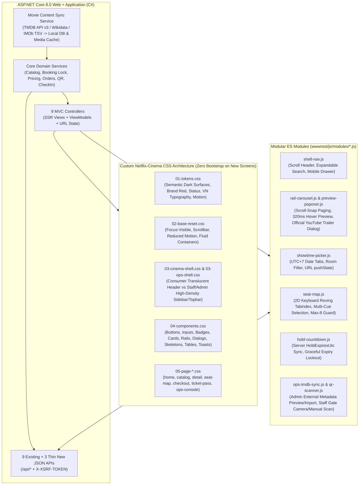

# FRONTEND ARCHITECTURE DECISION RECORD (ADR-UI-2026)

- **Dự án:** Hệ thống Bán vé Rạp chiếu phim Beta Giải Phóng (`BetaGiaiPhong.Web`)
- **Trạng thái:** Đề xuất Kiến trúc (Chưa thay đổi mã nguồn ứng dụng trong lượt lập kế hoạch)
- **Baseline khảo sát:** Nhánh `main` tại commit `4c0a38301bfae3b99f3bf7f16c88e50e0b920453` (sau Merge PR #12 — `UI-02B`, GitHub Actions Run `41570604111` PASS cả 4 job)
- **Vai trò lập kiến trúc:** Lead Product Designer, UX Architect & Frontend Architect

---

## 1. Bối cảnh và Bài toán Kiến trúc

Hệ thống Beta Giải Phóng hiện vận hành trên nền tảng **ASP.NET Core 8.0 MVC + Razor Views + EF Core SQL Server**, đi kèm song song **9 MVC Controllers** và **9 JSON API Controllers** (`/api/*`), cơ chế xác thực Cookie `.BetaGiaiPhong.Auth` (`HttpOnly`, `SameSite=Lax`), bảo vệ CSRF hai lớp (`@Html.AntiForgeryToken()` cho form và `X-XSRF-TOKEN` cho JSON API), cùng bộ kiểm thử nghiêm ngặt (**166 bài test xUnit** và **16+ kịch bản Playwright Chromium E2E** trên cơ sở dữ liệu tạm `BetaGiaiPhong_E2E_*`).

Qua khảo sát mã nguồn và kiểm chứng trực tiếp bằng trình duyệt thực tế trên toàn bộ 7 hành trình người dùng/vai trò, dự án đang đứng trước hai rào cản kiến trúc giao diện rõ rệt:

1. **Sự xung đột giữa hệ thống lớp Bootstrap 5 và mục tiêu thị giác chuẩn Netflix:**
   - Các giai đoạn `UI-01`, `UI-02A`, `UI-02B` đã tạo được nền tối bước đầu cho Trang chủ (`/`) và Khám phá phim (`/movies`, `/movies/{id}`), nhưng 18/23 màn hình còn lại (`Seats`, `Orders/*`, `Checkout`, `Account/*`, `StaffCheckIn/*`, `Management/*`) vẫn viết bằng các lớp tiện ích sáng của Bootstrap (`.bg-white`, `.bg-light`, `.bg-primary`, `.text-primary`, `.table-light`) rồi dùng [`dark-compat.css`](file:///d:/Projects/BetaGiaiPhong/src/BetaGiaiPhong.Web/wwwroot/css/dark-compat.css) ép màu tối bằng hàng loạt `!important`.
   - Hậu quả trực tiếp xác minh trên trình duyệt: nhãn phòng chiếu, nút phụ và tổng tiền bị nhuộm xanh dương `#0d6efd` chói mắt trên nền `#141414`; tooltip của Bootstrap trên sơ đồ ghế ([`Seats.cshtml`](file:///d:/Projects/BetaGiaiPhong/src/BetaGiaiPhong.Web/Views/Showtimes/Seats.cshtml)) hiển thị chữ xám tối trên nền đen gần như không đọc được; thông báo xác nhận hủy đơn/thanh toán lỗi dùng `window.confirm()` / `window.alert()` thô của trình duyệt; thẻ ghế dùng `
` thiếu ngữ nghĩa bàn phím (`<button>`, `aria-pressed`).
2. **Nhu cầu tương tác giàu chất điện ảnh và hiển thị dữ liệu phim thật 100%:**
   - Giao diện mục tiêu đòi hỏi header chuyển trạng thái trong suốt sang đặc khi cuộn, hero toàn chiều ngang với vùng chữ an toàn, thanh tìm kiếm tức thì trên header, hover/focus quick-preview card kiểu Netflix, modal xem trailer chính thức, bộ chọn ngày/suất chiếu `UTC+7` mượt mà, sơ đồ ghế đa dấu hiệu truy cập bằng bàn phím, đồng hồ giữ ghế đồng bộ từ server và bàn làm việc vận hành mật độ cao (kèm công cụ tra cứu/đồng bộ metadata phim thật từ TMDB/Wikidata).

Câu hỏi cốt lõi của tài liệu này: **Nên tiếp tục nâng cấp trên kiến trúc ASP.NET Core MVC/Razor (nhưng loại bỏ sự phụ thuộc thị giác vào Bootstrap), chuyển sang mô hình Hybrid SPA Islands (Vite + React/Vue), hay viết lại hoàn toàn bằng React/Next.js SPA độc lập?**

---

## 2. So sánh Khách quan 3 Phương án Kiến trúc Frontend

Bảng dưới đây đối chiếu 3 phương án theo đúng 10 tiêu chí kỹ thuật và sản phẩm của dự án:

| Tiêu chí đánh giá | Phương án A (Khuyến nghị): **MVC/Razor SSR Nâng cấp + Custom Netflix-Cinema CSS + Vanilla ES Modules & JSON Islands** | Phương án B: **Hybrid MVC Shell + Vite / React (hoặc Vue) Interactive Islands** | Phương án C: **Standalone SPA / Next.js Frontend + Pure REST API Backend** |
| :--- | :--- | :--- | :--- |
| **1. Khả năng đạt thiết kế chuẩn Netflix** | **Rất cao (9.5/10).** CSS Grid/Flexbox hiện đại, CSS Custom Properties, `scroll-snap`, View Transitions / CSS transitions, `<dialog>` chuẩn HTML5 và ES Modules đáp ứng trọn vẹn bố cục hero, card rail, hover preview popover, trailer modal, sơ đồ ghế và dark console mà không bị giới hạn bởi framework. | **Rất cao (9.5/10).** Thuận lợi cho component có state phức tạp trên client, nhưng dễ tạo sự lệch pha về kiểu dáng giữa phần Razor tĩnh và phần React island nếu không dùng chung CSS tokens chặt chẽ. | **Rất cao (10/10)** cho trải nghiệm chuyển trang không tải lại (client-side routing), tương tự ứng dụng web streaming của Netflix. |
| **2. Tái sử dụng Backend & Tránh nhân đôi nghiệp vụ** | **Tuyệt đối (10/10).** Giữ nguyên 100% nghiệp vụ đặt giữ ghế (`BookingService`), khóa chống tranh chấp (`UPDLOCK`/`HOLDLOCK`), tính tiền VND nguyên, kiểm tra hết hạn giữ chỗ (`HoldExpiresUtc`) và phân quyền trên C# ViewModel + API sẵn có. Không phải viết lại validation hay state machine ở client. | **Tốt (8/10).** Vẫn tái sử dụng backend C#, nhưng phải duy trì hai bộ kiểu dữ liệu (C# ViewModel cho SSR + TypeScript interfaces cho các đảo React). | **Trung bình – Thấp (5/10).** Buộc phải viết lại toàn bộ tầng routing, auth guard, form validation, flash state, xử lý trạng thái đơn/ghế trên client và mở rộng nhiều endpoint quản trị hiện chỉ có ở MVC (`ManagementController`). |
| **3. Authentication / Session / Cookie** | **Nguyên bản, an toàn nhất (10/10).** Cookie `.BetaGiaiPhong.Auth` (`HttpOnly`, `SameSite=Lax`, trượt 8 giờ) hoạt động tự nhiên trên cùng origin cho cả điều hướng trang và `fetch('/api/...')` với `credentials: 'same-origin'`. | **Tốt (8.5/10).** Cùng origin nên dùng lại được cookie `.BetaGiaiPhong.Auth`, nhưng cần truyền trạng thái user/role xuống từng island khi mount. | **Phức tạp (5/10).** Nếu chạy khác port/origin khi dev hoặc deploy tách rời sẽ phát sinh CORS, `SameSite`, preflight, đồng bộ trạng thái phiên đăng nhập giữa SSR của Next.js và Kestrel của ASP.NET Core. |
| **4. CSRF & Quyền truy cập theo vai trò** | **Nguyên bản (10/10).** Form POST tiếp tục dùng `@Html.AntiForgeryToken()`; các tương tác `fetch` đọc token từ `XSRF-TOKEN` -> header `X-XSRF-TOKEN` đã cấu hình sẵn trong [`Program.cs`](file:///d:/Projects/BetaGiaiPhong/src/BetaGiaiPhong.Web/Program.cs). Policy `RequireCustomer`, `StaffArea`, `ManagementArea` giữ nguyên tại server. | **Khá (7.5/10).** Mọi mutation trong React island phải bọc helper gắn `X-XSRF-TOKEN` và tự xử lý phản hồi `401`/`403` để chuyển hướng đăng nhập. | **Rủi ro cao (4.5/10).** Phải thiết kế lại luồng cấp CSRF token cho SPA khởi tạo độc lập, viết lại toàn bộ route guards cho `CUSTOMER`, `STAFF`, `MANAGER`, `ADMIN` và kiểm tra kỹ nguy cơ lộ màn hình trước khi redirect. |
| **5. Routes, `returnUrl` & Deep Links** | **Bảo toàn 100% (10/10).** Toàn bộ URL đang được kiểm thử (`/`, `/movies?q=&filter=`, `/movies/{id}?date=`, `/showtimes/{id}/seats`, `/orders/{id}/checkout`, `/account/login?returnUrl=...`, `/staff/check-in`, `/management/*`) giữ nguyên hợp đồng, hỗ trợ Progressive Enhancement khi tắt JS. | **Tốt (8.5/10).** URL cấp trang giữ nguyên bởi MVC; chỉ cần đồng bộ query string giữa Razor và island. | **Chi phí cao (5/10).** Phải ánh xạ lại toàn bộ bảng định tuyến trong React Router / Next.js App Router và kiểm thử lại mọi luồng `Url.IsLocalUrl(returnUrl)` để tránh lỗi Open Redirect hoặc vòng lặp đăng nhập. |
| **6. SSR, Tốc độ hiển thị đầu tiên (LCP) & SEO** | **Xuất sắc (10/10).** HTML trang chủ, danh mục và chi tiết phim trả về ngay từ Kestrel trong một vòng mạng kèm thẻ `` cho Hero backdrop; trình duyệt bắt đầu tải ảnh LCP ngay lập tức mà không chờ tải/giải nén bundle JS. | **Tốt (8/10).** Phần khung SSR nhanh, nhưng các đảo tương tác có hiện tượng hydration delay nếu lạm dụng cho phần trên màn hình đầu tiên (above-the-fold). | **Trung bình nếu CSR (5/10) / Phức tạp nếu Next.js SSR (6.5/10).** CSR làm chậm LCP do phải tải JS rồi mới gọi API lấy phim; Next.js SSR lại đòi hỏi chạy thêm một Node.js server đứng trước Kestrel. |
| **7. Hiệu năng & Tải ảnh (Media Performance)** | **Tối ưu (9.5/10).** Tổng JS cho mỗi trang chỉ khoảng `8–20 KB` (ES Modules thuần, không runtime framework). Băng thông được dành trọn cho ảnh poster/backdrop responsive (`srcset`, `sizes`, WebP/AVIF/JPEG, `loading="lazy"`, `decoding="async"`). | **Khá (7.5/10).** Thêm khoảng `45–150 KB` gzipped runtime + bundler manifest Vite trong `wwwroot/dist`. | **Nặng hơn đáng kể (6/10).** Bundle framework, router, data-fetching library và hydration payload làm tăng tổng trọng lượng tải trang không cần thiết cho bài toán đặt vé rạp. |
| **8. Khả năng Kiểm thử & Tương thích CI** | **Tương thích tức thì (10/10).** Không phá vỡ 166 test xUnit, runner `BetaGiaiPhong.Runner`, `static_schema_checks.py` hay cấu trúc `e2e/` Playwright hiện tại; có thể nâng cấp từng màn hình và giữ CI xanh sau mỗi PR. | **Trung bình (7/10).** Cần bổ sung bước `npm run build` trước `dotnet publish` trong [`.github/workflows/ci.yml`](file:///d:/Projects/BetaGiaiPhong/.github/workflows/ci.yml) và xử lý source-map / cache Vite. | **Chi phí rất lớn (3/10).** Gần như phải viết lại phần lớn bộ E2E, cấu hình chạy song song 2 server (Node + .NET) trong `e2e-env.ts` và CI GitHub Actions. |
| **9. Độ phức tạp vận hành (DevOps & Runtime)** | **Đơn giản nhất (10/10).** Duy nhất một tiến trình `dotnet run` / `dotnet publish` phục vụ cả giao diện, API và static media cache. Không cần trình biên dịch frontend chạy ngầm khi chấm đồ án hoặc demo bảo vệ. | **Trung bình (6.5/10).** Phát sinh pipeline build kép (`Node/Vite` + `.NET SDK`) ngay trong quá trình phát triển ứng dụng chính. | **Cao (4/10).** Vận hành 2 ứng dụng riêng biệt (reverse proxy / BFF / Docker multi-service), tăng rủi ro lỗi cấu hình môi trường khi bàn giao học thuật hoặc triển khai thực tế. |
| **10. Chi phí chuyển đổi, Bảo trì & Rollback** | **Thấp & An toàn theo từng PR (9.5/10).** Cho phép chuyển đổi cuốn chiếu từng cụm màn hình (8 giai đoạn độc lập), mỗi giai đoạn dễ dàng revert bằng 1 PR mà không ảnh hưởng các màn hình khác. | **Trung bình (6.5/10).** Tốn công dựng cầu nối Vite-Razor TagHelper và quản lý dependency npm trong thư mục web chính. | **Rất cao & Rủi ro trễ tiến độ (2.5/10).** Dễ rơi vào trạng thái “viết lại toàn hệ thống” kéo dài, làm gián đoạn các luồng nghiệp vụ đã ổn định ở RC-1. |

---

## 3. Quyết định Kiến trúc Khuyến nghị: Phương án A

### 3.1. Tuyên bố Quyết định
Chọn **Phương án A — Kiến trúc ASP.NET Core 8 MVC/Razor SSR Nâng cấp, kết hợp Hệ thống CSS Thiết kế Điện ảnh Độc lập (`bgp-*` Netflix-Cinema Design System — loại bỏ dần các lớp thị giác Bootstrap) và Kiến trúc JavaScript ES Modules + JSON Islands nhẹ**.

### 3.2. Lý do Cốt lõi (Tại sao không giữ Bootstrap, và tại sao không cần viết lại bằng React?)

1. **Vấn đề hiện tại nằm ở hệ thống CSS Bootstrap + dữ liệu giả lập, KHÔNG nằm ở Razor hay ASP.NET Core:**
   - Trình duyệt chỉ hiểu HTML, CSS và DOM/Web APIs. Lý do giao diện hiện tại chưa đạt chất lượng Netflix ở các trang chọn ghế, đơn hàng, vé và quản trị là vì HTML đang dùng `.card.bg-white`, `.bg-primary`, `.table-light`, emoji hệ thống và poster SVG tự vẽ, chứ không phải vì Razor không xuất được cấu trúc DOM đẹp.
   - Ngược lại, **SSR của Razor** cho phép xuất ngay trên lần phản hồi HTML đầu tiên toàn bộ cấu trúc Hero 16:9, `srcset` đa độ phân giải, thẻ JSON Island chứa dữ liệu preview đã xác minh và bảng suất chiếu `UTC+7` chính xác từ C# `DateTimeOffset` — điều mà SPA thuần phải tốn thêm vòng gọi mạng mới làm được.
2. **Loại bỏ triệt để Bootstrap khỏi tầng thị giác mà không gây “vỡ giao diện dây chuyền”:**
   - Thay vì dùng Bootstrap `.btn-primary`, `.badge`, `.card`, `.modal`, `.tooltip` rồi viết `dark-compat.css` đè `!important`, hệ thống thiết kế mới xây dựng bộ nguyên tử độc lập tiền tố `bgp-` (`bgp-shell`, `bgp-hero`, `bgp-rail`, `bgp-card`, `bgp-btn`, `bgp-chip`, `bgp-seat`, `bgp-pass`, `bgp-console`, `bgp-dialog`, `bgp-skeleton`).
   - Trong quá trình chuyển đổi (Giai đoạn 1 → Giai đoạn 7), `bootstrap.min.css` và `dark-compat.css` chỉ còn được nạp có điều kiện (`ViewData["UseLegacyBootstrap"] = true`) cho những màn hình chưa tới lượt nâng cấp; mọi màn hình đã nâng cấp đặt `ViewData["UseLegacyBootstrap"] = false` để hoàn toàn sạch bóng `!important` và màu xanh `#0d6efd` của Bootstrap. Khi hoàn tất Giai đoạn 7, `dark-compat.css` và Bootstrap được gỡ bỏ hoàn toàn khỏi dự án.
3. **Vanilla ES Modules + HTML5 `<dialog>` + JSON Islands giải quyết trọn vẹn tương tác kiểu Netflix:**
   - **Header Scroll Elevation & Inline Search:** Một module `shell-nav.js` (~3 KB) dùng `IntersectionObserver` / `scroll` passive listener chuyển header từ gradient trong suốt (`rgba(10,10,10,0.18)`) sang nền đặc kính mờ (`rgba(10,10,10,0.94)`) và mở ô tìm kiếm trượt ngang kiểu Netflix.
   - **Hover / Focus Quick-Preview Card & Trailer Modal:** Dữ liệu tóm tắt của các phim trên trang được nhúng sẵn một lần dưới dạng `<script type="application/json" id="bgp-movies-preview-data">` (hoặc tải lười qua `GET /api/movies/{id}/quick-preview` có cache bộ nhớ). Module `preview-popover.js` hiển thị thẻ nổi có trễ chủ đích `320ms` khi hover (tránh nhấp nháy khi lướt chuột nhanh), tự động căn lề trái/phải viewport, hỗ trợ bàn phím và tắt hiệu ứng phóng khi `prefers-reduced-motion: reduce`.
   - **Accessible Seat Matrix & Live Price Dock:** Module `seat-map.js` quản lý các phần tử `<button type="button" class="bgp-seat" aria-pressed="false">` hỗ trợ điều hướng mũi tên 2 chiều (`ArrowUp/Down/Left/Right`) trên ma trận hàng–cột, tính tổng tiền tức thì, hiển thị inline toast/banner khi chọn quá 8 ghế (thay thế hoàn toàn `window.alert()`), và gửi form/API giữ ghế nguyên tử.

---

## 4. Kiến trúc Phân lớp Frontend Đề xuất

### 4.1. Tách biệt Hai Khung Giao diện (Dual-Shell Architecture)
Một phát hiện quan trọng khi audit [`_Layout.cshtml`](file:///d:/Projects/BetaGiaiPhong/src/BetaGiaiPhong.Web/Views/Shared/_Layout.cshtml) hiện tại là thanh điều hướng đang trộn lẫn liên kết khách hàng (`Trang chủ`, `Phim đang chiếu`, `Đơn hàng của tôi`) với liên kết nội bộ (`Soát vé`, `Lịch sử soát vé`, `Vận hành`). Kiến trúc mới tách thành **2 Layout chuyên biệt dùng chung hệ Design Tokens**:

1. **`_CinemaLayout.cshtml` (Dành cho `Guest` và `CUSTOMER`):**
   - Header cố định `68px` chuyển mượt từ lớp phủ gradient tối trong suốt trên Hero sang nền `#0A0A0A` kính mờ khi `scrollY > 40px`.
   - Điều hướng gọn đúng tinh thần Netflix: Logo **BETA Giải Phóng** → `Trang chủ` → `Phim` → `Lịch chiếu` → (khi đăng nhập `CUSTOMER`: `Vé & Đơn hàng`) | Phải: Ô tìm kiếm mở rộng tức thì (`GET /movies?q=...`), nhãn nhỏ tinh tế `"Mô phỏng học thuật"`, menu tài khoản (kèm nút chuyển nhanh sang `"Bàn làm việc Vận hành"` nếu tài khoản đang đăng nhập là `STAFF`/`MANAGER`/`ADMIN`).
2. **`_OperationsLayout.cshtml` (Dành cho `/staff/*` và `/management/*`):**
   - Không dùng hero điện ảnh hay header trong suốt; sử dụng thanh điều hướng vận hành cố định mật độ cao (Sidebar thu gọn trên desktop + Topbar hiển thị ca trực/vai trò `STAFF` | `MANAGER` | `ADMIN`, trạng thái kết nối nguồn TMDB và nút quay về giao diện khách xem thử).

---

## 5. Kiểm kê API Hiện có và Đặc tả API Bổ sung

### 5.1. Các API & Controller Đã Có Sẵn (Tái sử dụng 100%, không viết lại nghiệp vụ)

| Phân hệ | MVC Controller (SSR / Form) | JSON API Controller (`/api/*`) | Ghi chú bảo toàn |
| :--- | :--- | :--- | :--- |
| **Khám phá phim** | [`HomeController`](file:///d:/Projects/BetaGiaiPhong/src/BetaGiaiPhong.Web/Controllers/HomeController.cs), [`MoviesController`](file:///d:/Projects/BetaGiaiPhong/src/BetaGiaiPhong.Web/Controllers/MoviesController.cs) | [`MoviesApiController`](file:///d:/Projects/BetaGiaiPhong/src/BetaGiaiPhong.Web/Api/MoviesApiController.cs) (`GET /api/movies`, `GET /api/movies/{id}`, `GET /api/movies/{id}/showtimes`) | Chỉ mở rộng DTO để trả thêm các trường dữ liệu phim thật đã xác minh (tên gốc, năm, backdrop, đạo diễn, diễn viên, trailer, điểm + nguồn + lượt bình chọn). |
| **Suất chiếu & Sơ đồ ghế** | [`ShowtimesController`](file:///d:/Projects/BetaGiaiPhong/src/BetaGiaiPhong.Web/Controllers/ShowtimesController.cs) (`GET /showtimes/{id}/seats`) | [`ShowtimesApiController`](file:///d:/Projects/BetaGiaiPhong/src/BetaGiaiPhong.Web/Api/ShowtimesApiController.cs) (`GET /api/showtimes/{id}/seat-map`) | Giữ nguyên logic giá theo tier `STANDARD`/`VIP` và trạng thái ghế `AVAILABLE`/`HELD`/`SOLD`. |
| **Giữ ghế (Hold)** | [`BookingsController`](file:///d:/Projects/BetaGiaiPhong/src/BetaGiaiPhong.Web/Controllers/BookingsController.cs) (`POST /bookings/reserve`) | [`BookingsApiController`](file:///d:/Projects/BetaGiaiPhong/src/BetaGiaiPhong.Web/Api/BookingsApiController.cs) (`POST /api/bookings/reserve`) | Giữ nguyên khóa giao dịch chống đặt trùng, giới hạn tối đa 8 ghế/đơn và redirect `returnUrl` cho khách chưa đăng nhập. |
| **Đơn hàng & Thanh toán** | [`OrdersController`](file:///d:/Projects/BetaGiaiPhong/src/BetaGiaiPhong.Web/Controllers/OrdersController.cs) (`Index`, `Details`, `Checkout`, `DemoPay`, `Cancel`) | [`OrdersApiController`](file:///d:/Projects/BetaGiaiPhong/src/BetaGiaiPhong.Web/Api/OrdersApiController.cs), [`PaymentsApiController`](file:///d:/Projects/BetaGiaiPhong/src/BetaGiaiPhong.Web/Api/PaymentsApiController.cs), [`WebhooksApiController`](file:///d:/Projects/BetaGiaiPhong/src/BetaGiaiPhong.Web/Api/WebhooksApiController.cs) | Giữ nguyên chữ ký HMAC-SHA256, `HoldExpiresUtc` từ server và xử lý `NEEDS_REVIEW` cho thanh toán trễ. |
| **Vé điện tử & Tài khoản** | [`OrdersController.Tickets`](file:///d:/Projects/BetaGiaiPhong/src/BetaGiaiPhong.Web/Controllers/OrdersController.cs), [`AccountController`](file:///d:/Projects/BetaGiaiPhong/src/BetaGiaiPhong.Web/Controllers/AccountController.cs) | [`TicketsApiController`](file:///d:/Projects/BetaGiaiPhong/src/BetaGiaiPhong.Web/Api/TicketsApiController.cs) (`GET /api/tickets/{code}/qr`), [`MeApiController`](file:///d:/Projects/BetaGiaiPhong/src/BetaGiaiPhong.Web/Api/MeApiController.cs) | Giữ nguyên mã hóa AES-GCM cho QR payload và kiểm tra quyền sở hữu đơn hàng. |
| **Soát vé & Quản trị** | [`StaffCheckInController`](file:///d:/Projects/BetaGiaiPhong/src/BetaGiaiPhong.Web/Controllers/StaffCheckInController.cs), [`ManagementController`](file:///d:/Projects/BetaGiaiPhong/src/BetaGiaiPhong.Web/Controllers/ManagementController.cs) | [`StaffTicketsApiController`](file:///d:/Projects/BetaGiaiPhong/src/BetaGiaiPhong.Web/Api/StaffTicketsApiController.cs) (`POST /api/staff/tickets/verify`, `POST /api/staff/tickets/check-in`) | Giữ nguyên phân quyền `StaffArea` (`STAFF`,`MANAGER`,`ADMIN`) và `ManagementArea` (`MANAGER`,`ADMIN`). |

### 5.2. Ba Nhóm Endpoint Mỏng Đề xuất Bổ sung (Trong các Giai đoạn Triển khai Tiếp theo)

1. **`GET /api/movies/{id}/quick-preview` (`AllowAnonymous`, có `OutputCache` ngắn 30–60 giây):**
   - **Mục đích:** Cung cấp dữ liệu nhẹ cho bảng Hover Quick-Preview hoặc Modal Chi tiết nhanh trên Trang chủ / Danh mục khi chưa nhúng sẵn trong JSON Island, bao gồm: `movieId`, `titleVi`, `originalTitle`, `releaseYear`, `durationMin`, `genres`, `vnAgeLabel`, `backdropSet`, `officialTrailerYoutubeId`, `ratingSummary` (`source`, `score`, `scaleMax`, `voteCount`, `fetchedUtc`), và tối đa 3 suất chiếu mở bán gần nhất theo `UTC+7`.
   - **Nguyên tắc:** Đọc 100% từ SQL Server nội bộ + cache ảnh đã đồng bộ; **tuyệt đối không gọi API TMDB/bên thứ ba trực tiếp trong request của khách hàng**.
2. **`GET /api/management/external-catalog/search` & `GET /api/management/external-catalog/{source}/{externalId}` (`[Authorize(Policy = "ManagementArea")]`):**
   - **Mục đích:** Cho phép `MANAGER`/`ADMIN` tìm kiếm phim thật theo tên, `TMDB ID` (`P4947`) hoặc `IMDb ID` (`tt...`) ngay trên màn hình tạo/sửa phim, xem trước poster, backdrop, đạo diễn, diễn viên, thời lượng, năm phát hành và giấy phép/nguồn trước khi lưu vào trạng thái `DRAFT`.
   - **Bảo mật:** Khóa `BGP_TMDB_READ_TOKEN` chỉ nằm ở biến môi trường / Secret Store phía server, không bao giờ gửi xuống trình duyệt. Khi môi trường chưa cấu hình `BGP_TMDB_READ_TOKEN`, endpoint trả mã trạng thái có cấu trúc `{ configured: false, fallbackSources: ["wikidata", "local-verified-seed"] }` để UI quản trị hiển thị hướng dẫn cấu hình trung thực thay vì báo lỗi 500.
3. **`POST /management/movies/{id}/sync-metadata` (`[Authorize(Policy = "ManagementArea")]`, `[ValidateAntiForgeryToken]`):**
   - **Mục đích:** Đồng bộ lại điểm đánh giá, số lượt đánh giá và artwork mới nhất cho một phim đã gắn `tmdb_id` / `imdb_id` / `wikidata_qid`, tôn trọng cờ `is_manual_override` trên các trường do quản trị viên khóa chỉnh sửa thủ công và ghi nhật ký đồng bộ.

---

## 6. Bảo toàn Phiên Đăng nhập, `returnUrl`, Quyền Truy cập và Xử lý Lỗi

1. **Luồng `returnUrl` xuyên suốt khi đặt vé chưa đăng nhập:**
   - Khách vãng lai (`Guest`) duyệt `/` → `/movies` → `/movies/{id}` → `/showtimes/{id}/seats` và được phép xem sơ đồ ghế, chọn thử ghế để biết tổng tiền.
   - Khi bấm CTA trên trang ghế (`"Đăng nhập để giữ ghế & thanh toán"`), hệ thống điều hướng an toàn tới `/account/login?returnUrl=%2Fshowtimes%2F{id}%2Fseats` (kiểm tra nghiêm ngặt bằng `Url.IsLocalUrl(returnUrl)` đã có trong [`AccountController`](file:///d:/Projects/BetaGiaiPhong/src/BetaGiaiPhong.Web/Controllers/AccountController.cs)). Tùy chọn cải tiến UX ở Giai đoạn 4: lưu tạm danh sách mã ghế khách vừa chọn vào `sessionStorage` gắn khóa `bgp_draft_seats_{showtimeId}` (TTL 10 phút) để sau khi đăng nhập quay lại đúng trang ghế, các ghế đó tự động được tô chọn lại nếu vẫn còn `AVAILABLE`.
2. **Xử lý hết hạn phiên (Session Expired) & hết hạn giữ ghế (`HoldExpiresUtc`):**
   - Với các lời gọi `fetch()` từ ES Modules (ví dụ soát vé QR hoặc tải preview quản trị), module dùng chung `http-client.js` kiểm tra `401 Unauthorized` để hiển thị thông báo phiên hết hạn rõ ràng kèm liên kết đăng nhập lại giữ nguyên `returnUrl`, và kiểm tra `403 Forbidden` để hiển thị trạng thái không đủ quyền mà không làm treo giao diện.
   - Trên trang `Orders/Details` và `Orders/Checkout`, bộ đếm ngược **chỉ tính từ chênh lệch giữa `HoldExpiresUtc` của server và `ServerNowUtc` truyền xuống tại thời điểm render** (`remainingSeconds` kết hợp `performance.now()` chống trôi nhịp khi tab trình duyệt chạy nền). Khi về `00:00`, UI khóa ngay nút thanh toán và hiển thị trạng thái `"Đã hết thời gian giữ ghế — Vui lòng kiểm tra lại tình trạng đơn hoặc chọn lại ghế"`, đồng thời backend vẫn là chốt chặn cuối cùng từ chối thanh toán quá hạn (chuyển `NEEDS_REVIEW` nếu phát sinh webhook trễ).
3. **Phân quyền hiển thị trung thực theo vai trò:**
   - `CUSTOMER`: Chỉ được giữ ghế và mua vé; không thấy thanh công cụ vận hành.
   - `STAFF`: Truy cập `/staff/check-in` và `/staff/check-in/history`; nếu bấm vào sơ đồ ghế công khai, khu vực đặt vé hiển thị rõ thông báo vai trò nhân viên không đặt vé bằng tài khoản công vụ (thay vì báo lỗi 403 bất ngờ sau khi bấm submit).
   - `MANAGER` & `ADMIN`: Toàn quyền quản lý danh mục phim, đồng bộ metadata ngoài, lập lịch chiếu, xem sơ đồ phòng và báo cáo doanh thu/tỷ lệ lấp đầy.

---

## 7. Chiến lược Tối ưu Hiệu năng & Tải Ảnh Điện ảnh

Để giao diện giàu hình ảnh như Netflix nhưng vẫn đạt điểm LCP nhanh và không gây giật bố cục (`CLS = 0`):

1. **Khóa tỷ lệ khung hình cứng (Zero CLS):**
   - Mọi khung poster dọc bắt buộc khai báo `aspect-ratio: 2 / 3` cùng `width`/`height` thuộc tính HTML; mọi khung backdrop/thumbnail ngang khai báo `aspect-ratio: 16 / 9`; vùng Hero khai báo `min-height: clamp(500px, 72vh, 780px)` để không bao giờ nhảy bố cục khi ảnh đang tải.
2. **Phân tầng kích thước ảnh (Không bao giờ tải ảnh gốc 4K cho thumbnail):**
   - **Poster dọc (`2:3`):** Lưu/phục vụ 2 mức `w342` (~25–45 KB cho card hàng phim/lưới mobile) và `w780` (~80–140 KB cho trang chi tiết phim / màn hình Retina) qua `srcset` và `sizes="(max-width: 575px) 46vw, (max-width: 991px) 30vw, 220px"`.
   - **Backdrop ngang (`16:9`):** Lưu/phục vụ 2 mức `w780` (cho hover preview / mobile hero) và `w1280` (~140–260 KB cho desktop hero & chi tiết phim).
3. **Ưu tiên tải thông minh:**
   - Duy nhất ảnh Hero đầu trang gắn `fetchpriority="high" decoding="async"` (không gắn `loading="lazy"`).
   - Toàn bộ ảnh từ hàng phim thứ hai trở xuống và các phần tử ngoài màn hình gắn `loading="lazy" decoding="async"` kèm nền chuyển sắc tối tinh tế (`.bgp-img-sheen`) trong lúc tải.

---

## 8. Chiến lược Chuyển đổi Từng phần & Rollback An toàn

Chúng ta áp dụng mô hình **Chuyển đổi Bề mặt Có Phạm vi (Scoped Surface Cutover)** bên trong cùng ứng dụng `BetaGiaiPhong.Web`:

1. **Bước 1 (Nền tảng song song):** Tạo bộ file CSS mới trong `wwwroot/css/cinema/` (`tokens.css`, `base.css`, `shell-cinema.css`, `shell-ops.css`, `components.css`) và `_CinemaLayout.cshtml` / `_OperationsLayout.cshtml` mà **chưa xóa** `_Layout.cshtml` và `dark-compat.css`.
2. **Bước 2 (Chuyển đổi theo cụm màn hình độc lập):** Mỗi giai đoạn trong Roadmap (từ Giai đoạn 1 đến Giai đoạn 7) chỉ chuyển `_ViewStart` hoặc `Layout = "_CinemaLayout"` / `"_OperationsLayout"` cho đúng các màn hình thuộc phạm vi giai đoạn đó, đồng thời cập nhật hoặc bổ sung test Playwright tương ứng.
3. **Cơ chế Rollback trong 1 bước:**
   - Vì hợp đồng URL, Controller Action, Form field names, Anti-CSRF và Database Transactions được giữ nguyên, nếu bất kỳ giai đoạn UI nào phát sinh lỗi hồi quy thị giác hoặc E2E, chỉ cần revert PR của giai đoạn đó (hoặc đổi lại `Layout = "_Layout"` cho view liên quan) mà không ảnh hưởng tới dữ liệu hay các màn hình đã hoàn thành trước đó.
   - Riêng các thay đổi mở rộng bảng dữ liệu phim ở Giai đoạn 2 sử dụng các cột `NULL`-able hoặc có `DEFAULT` an toàn, đảm bảo khả năng tương thích ngược 100% với truy vấn hiện hữu.
