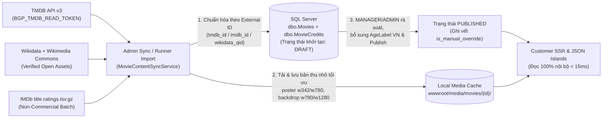

# KẾ HOẠCH DỮ LIỆU PHIM THẬT, NGUỒN XÁC MINH & MEDIA PIPELINE (`REAL_MOVIE_CONTENT_PLAN`)

- **Dự án:** Hệ thống Bán vé Rạp chiếu phim Beta Giải Phóng
- **Trạng thái:** Kế hoạch & Đặc tả Tích hợp (Đã xác minh nguồn thực tế & tải bộ asset hợp pháp cho Prototype; chưa sửa schema hay mã ứng dụng)
- **Thời điểm xác minh dữ liệu mẫu:** `2026-11-03T03:47:17Z` (`UTC`)

---

## 1. Nguyên tắc Cốt lõi: Nội dung Phim Thật 100% & Tách biệt Dữ liệu Tác phẩm – Vận hành Rạp

### 1.1. Hai Tầng Dữ liệu Độc lập (Bắt buộc Tách bạch)
Hệ thống Beta Giải Phóng là **hệ thống bán vé xem phim tại rạp vật lý**, không phải dịch vụ xem phim trực tuyến (streaming). Mọi cấu trúc cơ sở dữ liệu, API, ViewModel và nhãn hiển thị trên giao diện phải tách biệt tuyệt đối hai miền dữ liệu:

| Miền dữ liệu | Nguồn gốc sự thật (Source of Truth) | Các trường dữ liệu tiêu biểu | Quy tắc hiển thị & Nghiệp vụ |
| :--- | :--- | :--- | :--- |
| **1. Dữ liệu Tác phẩm Điện ảnh (`Film Work Data`)** | Các cơ sở dữ liệu điện ảnh có kiểm chứng (**TMDB API v3**, **Wikidata**, **IMDb Non-Commercial Datasets**, **Wikimedia Commons / Press Kit hãng phim**, **Cục Điện ảnh Việt Nam**) | Tên gốc (`OriginalTitle`), tên phát hành tại Việt Nam (`TitleVi`), năm phát hành (`ReleaseYear`), thời lượng (`DurationMin`), thể loại, quốc gia, ngôn ngữ gốc, đạo diễn, diễn viên & vai diễn, nội dung tóm tắt (`Synopsis`), poster chính thức, backdrop/still chính thức, trailer YouTube chính thức, điểm đánh giá kèm tên nguồn + thang gốc + số lượt bình chọn + ngày lấy, nhãn phân loại tuổi tại Việt Nam (nếu có hồ sơ). | **Phải là phim có thật 100%.** Tuyệt đối không bịa tên phim, không dùng poster vẽ SVG/AI giả làm poster chính thức, không tự chế tên đạo diễn/diễn viên hoặc điểm số. |
| **2. Dữ liệu Vận hành Rạp (`Cinema Operational Data`)** | Hệ thống nội bộ Beta Giải Phóng (`dbo.ScreeningRooms`, `dbo.Seats`, `dbo.Showtimes`, `dbo.PriceRules`, `dbo.Orders`, `dbo.Tickets`, `dbo.CheckInLogs`) | Phòng chiếu, sơ đồ ghế, suất chiếu (`StartUtc`/`EndUtc` hiển thị theo `UTC+7`), khung giá vé (`STANDARD`/`VIP`), ghế trống/đang giữ/đã bán, thời hạn giữ ghế (`HoldExpiresUtc`), mã đơn hàng, giao dịch thanh toán mô phỏng và mã QR soát vé. | Do `MANAGER`/`ADMIN` lập lịch trong hệ thống. Trong phạm vi đề án học thuật MIS, dữ liệu lịch chiếu & giá vé được gắn nhãn tinh tế nhưng rõ ràng: **“Lịch chiếu & giá vé mô phỏng học thuật — Nội dung tác phẩm từ nguồn xác minh”**. |

### 1.2. Ngữ nghĩa Nhãn Trạng thái Có Căn cứ (Grounded UI Badges)
Tuyệt đối không suy diễn một bộ phim “Đang chiếu tại Beta Giải Phóng” chỉ vì bộ phim đó có trạng thái `Now Playing` trên TMDB hoặc vừa ra rạp quốc tế:

- **`Có lịch chiếu` (`UpcomingShowtimesCount > 0`):** Chỉ xuất hiện khi trong `dbo.Showtimes` có ít nhất một suất chiếu trạng thái `OPEN` và `StartUtc > UtcNow` gắn với `MovieId` đó.
- **`Chưa có lịch chiếu` (`UpcomingShowtimesCount == 0`):** Áp dụng cho phim đã `PUBLISHED` trong danh mục khám phá nhưng rạp chưa mở suất chiếu sắp tới.
- **`Sắp phát hành ({ReleaseDate} • {Market})`:** Chỉ hiển thị khi trường ngày phát hành đã được xác minh từ nguồn chính thức và lớn hơn ngày hiện tại, ghi rõ thị trường áp dụng (ví dụ `VN` hoặc `Quốc tế`).
- **Tuyệt đối cấm các nhãn ngụy tạo:** Không hiển thị `"98% phù hợp"`, `"Top 10 tại Việt Nam hôm nay"`, `"Phim bán chạy nhất"`, lượt xem giả hoặc bảng xếp hạng nội bộ khi hệ thống chưa có dữ liệu thống kê thực tế được phép công bố.

### 1.3. Cô lập Hoàn toàn Dữ liệu Kiểm thử Tổng hợp (Synthetic Test Fixtures)
- Các bản ghi tổng hợp phục vụ kiểm thử biên và kiểm thử lỗi tự động trong `BetaGiaiPhong.Runner` (ví dụ tiêu đề dài 180 ký tự, phim nháp ẩn/hiện, suất chiếu giao tranh khóa ghế) **chỉ được phép tồn tại trong cơ sở dữ liệu tạm thời `BetaGiaiPhong_E2E_*`** khi chạy bộ test cô lập.
- Toàn bộ giao diện trình diễn, bộ dữ liệu seed mặc định cho môi trường trải nghiệm/nghiệm thu (`seed-verified-showcase`) và bộ ảnh chụp nghiệm thu thị giác phải sử dụng **100% phim thật từ danh mục đã xác minh**.

---

## 2. Khảo sát & Đánh giá Chi tiết Các Nguồn Dữ liệu Tích hợp

Không có một nguồn đơn lẻ nào vừa miễn phí vô điều kiện, vừa có đủ poster/backdrop độ phân giải cao, vừa có điểm IMDb và nhãn kiểm duyệt Cục Điện ảnh Việt Nam. Do đó, hệ thống sử dụng chiến lược **Đa nguồn có phân vai rõ ràng (Multi-Source Authoritative Mapping)**:

| Nguồn dữ liệu | Trường dữ liệu cung cấp | Cách truy cập & Yêu cầu khóa | Attribution & Điều kiện sử dụng / Lưu trữ / Cache | Giới hạn & Chi phí | Mức phù hợp (Học thuật vs Thương mại) |
| :--- | :--- | :--- | :--- | :--- | :--- |
| **1. TMDB API v3** (`api.themoviedb.org/3` & `image.tmdb.org`) | Tên gốc, tên bản địa hóa (`vi-VN`, fallback `en-US`), năm phát hành, thời lượng, thể loại, quốc gia, ngôn ngữ, synopsis, đạo diễn & dàn diễn viên (`credits`), video trailer chính thức (`videos`), poster (`w342`, `w500`, `w780`) và backdrop/logo (`w780`, `w1280`), điểm người dùng TMDB (`vote_average` / 10 + `vote_count`). | REST JSON qua HTTPS Bearer Token (`BGP_TMDB_READ_TOKEN`). Yêu cầu đăng ký tài khoản TMDB Developer miễn phí. | **Bắt buộc:** Đặt logo chính thức của TMDB tại footer/trang chi tiết và câu tuyên bố nguyên văn: *"This product uses the TMDB API but is not endorsed or certified by TMDB."* **Giới hạn cache:** Điều khoản TMDB yêu cầu không lưu trữ vĩnh viễn dữ liệu thay đổi quá **6 tháng (180 ngày)** mà không đồng bộ lại hoặc xóa khi ngừng dùng. | Khoảng `~40–50 requests/giây` theo IP. **Miễn phí ($0)** cho dự án học thuật, nghiên cứu, phi thương mại. Nếu vận hành bán vé thu doanh thu thật phải ký hợp đồng thương mại (`sales@themoviedb.org`). | **Nguồn chính lý tưởng** cho nguyên mẫu học thuật sau khi cấu hình `BGP_TMDB_READ_TOKEN`; cần nâng cấp giấy phép nếu thương mại hóa. |
| **2. Wikidata SPARQL & REST API + Wikimedia Commons** | Định danh liên thông chuẩn xác (`Wikidata QID`, `IMDb ID P345`, `TMDB ID P4947`), tên tiếng Việt/tiếng Anh, ngày phát hành, thời lượng, đạo diễn, mã trailer YouTube (`P1651`), và các poster/still thuộc **Phạm vi công cộng (`Public Domain`)** hoặc giấy phép mở **`CC0` / `CC BY 3.0` / `CC BY 4.0`**. | Truy vấn HTTPS công khai (`query.wikidata.org/sparql`, `commons.wikimedia.org/w/api.php`) kèm header `User-Agent` định danh dự án. Không bắt buộc API key. | Dữ liệu thực thể Wikidata thuộc `CC0 1.0`. Với từng file ảnh trên Wikimedia Commons, **phải kiểm tra thẻ giấy phép của chính file đó** (không suy diễn công khai = tự do): chỉ tải/nhúng các file `Public Domain`, `CC0`, `CC BY 3.0`, `CC BY 4.0` và ghi đầy đủ tên tác giả + liên kết giấy phép + nguồn gốc. | Miễn phí ($0). Tuân thủ chính sách `User-Agent` và tải thumbnail đúng kích thước cần dùng (`iiurlwidth=600` / `1280`), không quét hàng loạt gây quá tải. | **Hợp pháp 100% cho cả Prototype tĩnh trong Git, đồ án học thuật lẫn sản phẩm thương mại** mà không phụ thuộc API key bí mật. |
| **3. IMDb Non-Commercial Datasets** (`datasets.imdbws.com`) | Điểm trung bình người xem IMDb (`averageRating` trên thang `10.0`) và tổng số lượt bình chọn (`numVotes`) khớp chính xác theo mã `tconst` (`tt...`) từ file `title.ratings.tsv.gz` cập nhật hàng ngày. | Tải file nén TSV chính thức qua HTTPS trong tác vụ đồng bộ nền phía server/CLI (`Runner sync-imdb-ratings`). Không cần API key; **nghiêm cấm cào HTML (`scraping`) trang web `imdb.com`**. | Chỉ dùng cho mục đích cá nhân / học thuật **phi thương mại**. **Bắt buộc ghi nguồn:** *"Information courtesy of IMDb (https://www.imdb.com). Used with permission."* Hiển thị kèm số lượt đánh giá và ngày cập nhật. | Miễn phí ($0) cho mục đích phi thương mại. Nếu triển khai thương mại phải mua gói **IMDb Essential / Box Office Data API qua AWS Data Exchange**. | **Rất phù hợp cho đồ án học thuật MIS** để có điểm IMDb thật 100% không vi phạm điều khoản chống cào dữ liệu. |
| **4. Kênh YouTube Chính thức của Hãng phim / Studio** | Video trailer hoặc trích đoạn quảng bá chính thức của tác phẩm (ví dụ Universal Pictures, Columbia Pictures, Blender Studio). | Nhúng qua trình phát chuẩn `youtube-nocookie.com/embed/{videoId}` (chế độ tăng cường quyền riêng tư, chỉ nạp iframe khi người dùng bấm nút **“Xem trailer chính thức”**) hoặc mở liên kết trực tiếp. | Tuân thủ YouTube Terms of Service: giữ nguyên khung điều khiển & thương hiệu trình phát YouTube, không tự tải file video thương mại về máy chủ riêng, kiểm tra cờ `embeddable`. | Miễn phí ($0), không tốn băng thông máy chủ ứng dụng và không làm chậm tải trang ban đầu nhờ cơ chế click-to-load. | **Phù hợp cho cả nguyên mẫu học thuật và triển khai thực tế.** |
| **5. Phân loại Độ tuổi Phổ biến Phim tại Việt Nam** (`Thông tư 05/2023/TT-BVHTTDL` — Cục Điện ảnh) | 6 mức phân loại chính thức tại rạp Việt Nam: **`P`** (mọi độ tuổi), **`K`** (dưới 13 tuổi xem cùng cha mẹ/người giám hộ), **`T13`** (`13+`), **`T16`** (`16+`), **`T18`** (`18+`) và **`C`** (cấm phổ biến — không được mở bán vé). | Hiện Cục Điện ảnh chưa mở REST API công khai tra cứu tự động từng phim. Dữ liệu chỉ được nhập bởi `MANAGER`/`ADMIN` khi đối chiếu thông tin giấy phép phổ biến phim tại Việt Nam hoặc công bố chính thức của nhà phát hành tại Việt Nam, kèm trường `age_rating_source`. | **Quy tắc nghiêm ngặt:** Tuyệt đối **không tự động quy đổi** nhãn nước ngoài (`PG`, `PG-13`, `R`, `NC-17`, `TV-MA`) sang `P`/`K`/`T13`/`T16`/`T18`. Nếu phim chưa có thông tin phân loại tại Việt Nam, lưu `vn_age_label = NULL` và giao diện hiển thị trung tính `"Chưa có phân loại tại VN"` (hoặc ẩn chip độ tuổi trên card nhỏ). | Không phát sinh chi phí API; kiểm soát bằng quy trình biên tập của Quản trị viên rạp. | **Bắt buộc tuân thủ** để trung thực về mặt pháp lý và học thuật tại thị trường Việt Nam. |

---

## 3. Quy tắc Chuẩn hóa Hiển thị Điểm Đánh giá, Độ tuổi & Dữ liệu Khuyết

### 3.1. Chuẩn Hiển thị Điểm Đánh giá (Rating Integrity Contract)
Mọi vị trí hiển thị điểm đánh giá (Hero, Hover Preview, Danh mục, Chi tiết phim) phải tuân thủ công thức hiển thị 4 thành phần:

> **`[Tên nguồn gốc] [Điểm số]/[Thang gốc] ([Số lượt đánh giá])`** + chú giải thời điểm đồng bộ ở trang chi tiết/chân trang.
> - Ví dụ đúng: **`IMDb 7.8/10 (95.223 lượt)`** *(Nguồn: IMDb Non-Commercial Dataset, cập nhật 03/11/2026)* hoặc **`TMDB 7.6/10 (1.420 lượt)`**.
> - Ví dụ bị cấm: `⭐ 7.8`, `IMDb 7.6` (nhưng thực chất lấy từ `tmdb.vote_average`), `78% Điểm khán giả` (tự nhân 10 từ thang 10), `Top #1 Phim hay nhất`, hoặc hiển thị `0.0/10` khi phim chưa có lượt đánh giá.
> - Nếu `rating_score IS NULL` hoặc `rating_vote_count == 0`: **Ẩn hoàn toàn khối điểm đánh giá**, không bịa số mặc định.

### 3.2. Ma trận Xử lý Khi Thiếu Dữ liệu hoặc Lỗi Ảnh (Graceful Degradation)

| Tình huống thiếu dữ liệu | Cách xử lý trên Giao diện Khách hàng (`_CinemaLayout`) | Quy tắc đủ điều kiện lên **Hero Trang chủ** |
| :--- | :--- | :--- |
| **Thiếu Backdrop `16:9` đủ độ phân giải (`< 1200px` ngang) hoặc chưa có quyền dùng ảnh** | Trên trang Chi tiết phim `/movies/{id}`: sử dụng nền kiến trúc ánh sáng tối đa lớp tinh tế (`.bgp-detail-ambient-stage`), giữ nguyên khung Poster `2:3` chuẩn (nếu có) — **không kéo giãn poster dọc thành ảnh ngang mờ vỡ**. | **LOẠI KHỎI HERO.** Phim thiếu backdrop thật hợp lệ tự động không được chọn làm `HeroMovie` trên Trang chủ. |
| **Thiếu Poster `2:3` hoặc URL ảnh bị lỗi tải (`onerror`)** | Hiển thị khung tỷ lệ `2:3` nền than chì `#18181B` viền mảnh `#27272A` với biểu tượng cuộn phim tối giản và dòng chữ rõ ràng: **`Chưa có hình ảnh`** kèm tên phim bên dưới. Tuyệt đối không chèn poster vẽ giả hay ảnh ngẫu nhiên. | **LOẠI KHỎI HERO** và xếp sau các phim có đủ artwork trong trang khám phá. |
| **Thiếu Tên phát hành tiếng Việt (`TitleVi`)** | Hiển thị `OriginalTitle` làm tiêu đề chính, không tự dịch máy tùy tiện tên phim sang tiếng Việt nếu chưa có tên phát hành được xác minh. | Được phép lên Hero nếu các điều kiện bắt buộc khác đều đạt. |
| **Thiếu Synopsis tiếng Việt** | Nếu có synopsis tiếng Anh đã xác minh từ TMDB/Wikidata thì hiển thị kèm nhãn nhỏ `(Tóm tắt gốc tiếng Anh)` hoặc nếu cả hai đều trống thì ghi trung thực: **`Chưa có thông tin nội dung tóm tắt cho tác phẩm này.`** | **LOẠI KHỎI HERO** nếu không có tóm tắt hợp lệ. |
| **Thiếu Đạo diễn / Diễn viên / Trailer / Điểm đánh giá / Phân loại tuổi VN** | Trường nào không có dữ liệu thì ẩn khối phụ tương ứng (ví dụ không hiện nút `"Xem trailer"` nếu `OfficialTrailerYoutubeId IS NULL`; ghi `"Chưa có phân loại tại VN"` tại bảng thông tin chi tiết). | Trailer và điểm đánh giá là tùy chọn trên Hero; nếu không có trailer thì chỉ hiển thị nút `"Đặt vé / Xem suất chiếu"` và `"Chi tiết phim"`. |

---

## 4. Pipeline Đồng bộ Nội dung, Cache Ảnh Cục bộ & Quản lý Khóa Bí mật

### 4.1. Luồng Đồng bộ Không Phụ thuộc Thời gian Thực (Zero Runtime Third-Party Dependency)
Trang chủ, Danh mục, Chi tiết phim và đặc biệt là luồng Đặt ghế / Thanh toán **tuyệt đối không gọi API TMDB, Wikidata hay IMDb trong lúc phục vụ khách hàng**:

1. **Định danh nguồn ngoài chống ghép nhầm phim trùng tên / bản làm lại (Remake):**
   - Mỗi bản ghi phim thật lưu bộ ba khóa định danh ngoài có ràng buộc duy nhất khi khác `NULL`: `tmdb_id` (`INT`), `imdb_id` (`VARCHAR(16)` dạng `tt...`), và `wikidata_qid` (`VARCHAR(16)` dạng `Q...`) cùng `release_year` (`SMALLINT`). Ví dụ phim *Mai* (`2024`, đạo diễn Trấn Thành) được khóa cứng vào `wikidata_qid = 'Q124516759'`, `imdb_id = 'tt31174028'`, `tmdb_id = 1210973` — không bao giờ ghép nhầm sang các bộ phim ngắn hoặc phim quốc tế khác cùng tên *"Mai"*.
2. **Ngôn ngữ ưu tiên và cơ chế Fallback rõ ràng:**
   - Khi đồng bộ từ TMDB/Wikidata: truy vấn `vi-VN` trước cho `TitleVi` và `SynopsisVi`; đồng thời luôn lưu `OriginalTitle` (`original_language`) và bản `en-US` dự phòng. Đối với Poster/Backdrop, ưu tiên poster phát hành tại Việt Nam (`iso_639_1 = 'vi'`) nếu có, sau đó đến poster ngôn ngữ gốc hoặc không chữ (`null`/`en`).
3. **Quy trình Kiểm duyệt (`DRAFT` → `PUBLISHED`) & Ghi đè Thủ công Có Truy vết (`Manual Override`):**
   - Mọi phim mới nhập từ nguồn ngoài mặc định mang trạng thái `DRAFT` để `MANAGER`/`ADMIN` kiểm tra hình ảnh, tên tiếng Việt và nhập nhãn độ tuổi Việt Nam (`P`/`K`/`T13`/`T16`/`T18`) nếu có căn cứ.
   - Bổ sung trường JSON/cờ `manual_override_fields` + `last_override_by_user_id` + `last_override_utc`. Nếu Quản trị viên đã hiệu đính bản dịch tóm tắt tiếng Việt hoặc khóa nhãn độ tuổi `T18`, lần chạy đồng bộ điểm số/ảnh định kỳ tiếp theo sẽ **không ghi đè** các trường đã khóa thủ công này.
4. **Chính sách Cache, Hết hạn (TTL) & Chống đứt gãy Nguồn ngoài:**
   - Tuân thủ điều khoản TMDB: mỗi bản ghi đồng bộ từ TMDB có `external_metadata_expires_utc = synced_utc + 180 days` (tối đa 6 tháng). Trang Quản trị hiển thị cảnh báo sớm trước 14 ngày cho các phim sắp hết hạn cache để bấm đồng bộ lại.
   - Nếu API TMDB hoặc mạng bên ngoài bị gián đoạn tại thời điểm bấm đồng bộ, hệ thống **giữ nguyên bản dữ liệu hợp lệ gần nhất trong DB và ảnh trong cache cục bộ**, ghi bản ghi `FAILED` vào nhật ký đồng bộ kèm lý do, không bao giờ xóa trắng dữ liệu đang phục vụ khách đặt vé.

### 4.2. Cấu hình Khóa Bí mật & Những Kết nối Còn Thiếu Trước Khi Vận hành Đầy đủ
- **Không lưu khóa bí mật trong mã nguồn, appsettings.json hoặc JavaScript trình duyệt.**
- Đề xuất biến môi trường / User Secrets chuẩn hóa theo tiền tố hiện có của dự án (`BGP_*` trong [`ServiceRegistration.cs`](file:///d:/Projects/BetaGiaiPhong/src/BetaGiaiPhong.Infrastructure/Configuration/ServiceRegistration.cs)):
  - `BGP_TMDB_READ_TOKEN`: Khóa API Read Access Token (v4 Bearer) của TMDB dùng riêng ở tầng Backend (`MovieContentSyncService`). Cấu hình trên máy phát triển qua `dotnet user-secrets set "Tmdb:ReadToken" "..."` hoặc biến môi trường hệ điều hành.
  - `BGP_MEDIA_CACHE_DIR`: Đường dẫn thư mục lưu ảnh đã tải về cục bộ (mặc định `wwwroot/media/movies`, tách biệt khỏi git đối với ảnh lấy từ TMDB theo TTL).
- **Trạng thái kết nối hiện tại (Ghi nhận trung thực):**
  - Hiện môi trường **chưa cấu hình `BGP_TMDB_READ_TOKEN`**.
  - Vì vậy, trong lượt lập kế hoạch và dựng Prototype này, chúng tôi **không sử dụng bất kỳ ảnh poster thương mại nào chưa có giấy phép lưu tĩnh**, mà xác minh trực tiếp qua **Wikidata API + IMDb Non-Commercial Dataset (`title.ratings.tsv.gz`) + Wikimedia Commons API** để tuyển chọn 9 bộ phim thật có đầy đủ artwork hợp pháp (`Public Domain` / `CC0` / `CC BY 3.0` / `CC BY 4.0`) kết hợp 2 bộ phim điện ảnh Việt Nam năm 2024 (*Mai*, *Đào, phở và piano*) được đánh dấu rõ trạng thái `PENDING_TMDB_API_KEY` để minh họa trung thực cả giao diện đầy đủ artwork lẫn cơ chế xử lý phim chờ đồng bộ ảnh.

---

## 5. Kế hoạch Mở rộng Schema Cơ sở Dữ liệu An toàn (Thực thi ở Giai đoạn 2)

> **Lưu ý quan trọng từ Audit CI:** Script [`.github/workflows/ci.yml`](file:///d:/Projects/BetaGiaiPhong/.github/workflows/ci.yml) hiện chạy [`scripts/static_schema_checks.py`](file:///d:/Projects/BetaGiaiPhong/scripts/static_schema_checks.py), kiểm tra cứng số lượng bảng (`17`), tổng số cột (`116`) và tổng số khóa ngoại (`22`) giữa [`sql/01_reference_schema_SQL_ONLY.sql`](file:///d:/Projects/BetaGiaiPhong/sql/01_reference_schema_SQL_ONLY.sql) và [`BetaModelConfiguration.cs`](file:///d:/Projects/BetaGiaiPhong/src/BetaGiaiPhong.Infrastructure/Persistence/Configurations/BetaModelConfiguration.cs). Mọi thay đổi schema ở Giai đoạn 2 **phải cập nhật đồng bộ** EF Core Migration, cấu hình Fluent API, file SQL tham chiếu, Data Dictionary và hằng kiểm tra trong `static_schema_checks.py` trong cùng một PR.

### 5.1. Mở rộng Bảng `dbo.Movies` (Tương thích ngược 100% — Các cột mới đều `NULL`-able hoặc có `DEFAULT`)
Hiện `dbo.Movies` chỉ có 8 cột (`movie_id`, `title`, `duration_min`, `genre_text`, `age_label`, `synopsis`, `poster_url`, `status`). Đề xuất bổ sung các cột có kiểm chứng nguồn:
- **Định danh & Bản địa hóa:** `original_title NVARCHAR(250) NULL`, `release_year SMALLINT NULL`, `release_date_vn DATE NULL`, `origin_country NVARCHAR(100) NULL`, `original_language VARCHAR(16) NULL`, `tmdb_id INT NULL`, `imdb_id VARCHAR(16) NULL`, `wikidata_qid VARCHAR(16) NULL` (kèm Filtered Unique Index cho từng mã khi `IS NOT NULL`).
- **Artwork, Trailer & Bản quyền ảnh:** `poster_w342_url NVARCHAR(500) NULL`, `backdrop_url NVARCHAR(500) NULL`, `backdrop_w780_url NVARCHAR(500) NULL`, `title_logo_url NVARCHAR(500) NULL`, `official_trailer_youtube_id VARCHAR(32) NULL`, `artwork_source VARCHAR(32) NULL` (`TMDB` | `WIKIMEDIA_COMMONS` | `DISTRIBUTOR` | `NONE`), `artwork_license_text NVARCHAR(300) NULL`, `artwork_attribution_text NVARCHAR(500) NULL`.
- **Điểm đánh giá có nguồn & Thời điểm lấy:** `rating_source VARCHAR(32) NULL` (`IMDB` | `TMDB`), `rating_value DECIMAL(3,1) NULL`, `rating_scale_max DECIMAL(4,1) NULL`, `rating_vote_count INT NULL`, `rating_fetched_utc DATETIME2(0) NULL`.
- **Phân loại tuổi & Quản trị đồng bộ:** `age_label_market VARCHAR(8) NULL` (chỉ nhận `'VN'` khi hiển thị nhãn `P/K/T13/T16/T18/C` chính thức), `age_label_source NVARCHAR(200) NULL`, `director_names NVARCHAR(300) NULL`, `cast_summary_json NVARCHAR(MAX) NULL` (hoặc bảng con `dbo.MovieCredits` cho tìm kiếm theo diễn viên/nhân vật), `metadata_source VARCHAR(32) NULL`, `external_synced_utc DATETIME2(0) NULL`, `external_expires_utc DATETIME2(0) NULL`, `manual_override_mask NVARCHAR(500) NULL`.

---

## 6. Bộ Nội dung Mẫu 11 Phim Thật Đã Xác Minh (`Verified Showcase Dataset`)

Toàn bộ 11 bộ phim dưới đây là **tác phẩm điện ảnh có thật 100%**, đã được đối chiếu chéo tự động giữa **Wikidata SPARQL API** và tập dữ liệu chính thức **IMDb Non-Commercial Dataset (`datasets.imdbws.com/title.ratings.tsv.gz`)** vào lúc **`2026-11-03T03:47:17Z`**, đồng thời tải về cục bộ 20 file poster/backdrop/logo có giấy phép hợp lệ trong [`docs/ui/prototype/assets/ASSET_MANIFEST.json`](file:///d:/Projects/BetaGiaiPhong/docs/ui/prototype/assets/ASSET_MANIFEST.json).

### 6.1. Bảng Tổng hợp Định danh, Nguồn Điểm & Quyền Sử dụng Artwork

| # | Tên hiển thị (VN / Quốc tế) & Năm | Định danh nguồn đã xác minh | Thời lượng & Đạo diễn | Điểm đánh giá thật (`2026-11-03 UTC`) | Trailer chính thức | Trạng thái Artwork trong Prototype & Giấy phép | Trạng thái Lịch chiếu Rạp (Mô phỏng) |
| :--- | :--- | :--- | :--- | :--- | :--- | :--- | :--- |
| **1** | **Mê trong mê** (*Charade*, 1963) | `wd:Q496266` `imdb:tt0056923` `tmdb:4808` | `113 phút` Stanley Donen | **IMDb `7.8/10`** (`95.223` lượt) | YouTube: `BJ_njww9SOQ` | **Sẵn sàng** (`charade-1963-poster.jpg`, `charade-1963-backdrop.jpg`) — **Public Domain** | `Có lịch chiếu` (Suất chiếu tiêu điểm — **Hero chính**) |
| **2** | **Charge** (2022) | `wd:Q115715270` `imdb:tt24787066` `tmdb:1062079` | `4 phút` Hjalti Hjálmarsson | **IMDb `7.6/10`** (`71` lượt) | YouTube: `UXqq0ZvbOnk` | **Sẵn sàng** (`charge-2022-poster.jpg`, `backdrop`, `logo.png`) — **CC BY 4.0** (Blender Studio) | `Có lịch chiếu` (Chương trình Chuyên đề Hoạt hình & Kỹ xảo) |
| **3** | **Tears of Steel** (2012) | `wd:Q1173161` `imdb:tt2285752` `tmdb:133701` | `12 phút` Ian Hubert | **IMDb `5.5/10`** (`1.576` lượt) | YouTube: `R6MlUcmOul8` | **Sẵn sàng** (`tears-of-steel-2012-poster.png`, `backdrop.jpg`) — **CC BY 3.0** (Blender Foundation \| Project Mango) | `Có lịch chiếu` |
| **4** | **Sintel** (2010) | `wd:Q925587` `imdb:tt1727587` `tmdb:45745` | `15 phút` Colin Levy | **IMDb `7.4/10`** (`3.802` lượt) | YouTube: `eRsGyueVLvQ` | **Sintel** (`sintel-2010-poster.jpg`, `backdrop.jpg`) — **CC BY 3.0** (Blender Foundation) | `Có lịch chiếu` |
| **5** | **Spring** (2019) | `wd:Q62770443` `imdb:tt9249278` `tmdb:593048` | `8 phút` Andy Goralczyk | **IMDb `7.2/10`** (`292` lượt) | YouTube: `WhWc3b3KhnY` | **Sẵn sàng** (`spring-2019-poster.jpg` **CC BY 4.0**, `backdrop.png` **CC0**) | `Có lịch chiếu` |
| **6** | **Cosmos Laundromat** (2015) | `wd:Q20968125` `imdb:tt4957236` `tmdb:358332` | `12 phút` Mathieu Auvray | **IMDb `6.8/10`** (`1.204` lượt) | YouTube: `Y-rmzh0PI3c` | **Sẵn sàng** (`cosmos-2015-poster.jpg` **CC BY 4.0**, `backdrop.jpg` **CC BY 3.0**) | `Chưa có lịch chiếu` |
| **7** | **Night of the Living Dead** (1968) | `wd:Q623051` `imdb:tt0063350` `tmdb:10331` | `96 phút` George A. Romero | **IMDb `7.8/10`** (`153.645` lượt) | YouTube: `jflXLvFb_wo` | **Sẵn sàng** (`notld-1968-poster.jpg`, `backdrop.jpg`) — **Public Domain** | `Có lịch chiếu` (Suất Đêm Kinh điển) |
| **8** | **His Girl Friday** (1940) | `wd:Q1066714` `imdb:tt0032599` `tmdb:3085` | `92 phút` Howard Hawks | **IMDb `7.8/10`** (`68.904` lượt) | YouTube: `5pVxMeditpM` | **Sẵn sàng** (`his-girl-friday-1940-poster.jpg`, `backdrop.jpg`) — **Public Domain** | `Có lịch chiếu` |
| **9** | **The General** (1926) | `wd:Q850159` `imdb:tt0017925` `tmdb:961` | `78 phút` Clyde Bruckman, Buster Keaton | **IMDb `8.1/10`** (`106.657` lượt) | YouTube: `lbzorV_jEW8` | **Sẵn sàng** (`the-general-1926-poster.png`, `backdrop.jpg`) — **Public Domain** | `Chưa có lịch chiếu` |
| **10** | **Mai** (2024) | `wd:Q124516759` `imdb:tt31174028` `tmdb:1210973` | `131 phút` Trấn Thành | **IMDb `6.9/10`** (`1.926` lượt) | Chưa gắn ID nhúng tĩnh | **`PENDING_TMDB_API_KEY`** — Chưa lưu poster thương mại khi chưa kết nối khóa TMDB; dùng placeholder trung tính **`Chưa có hình ảnh`**, loại khỏi Hero | `Chưa có lịch chiếu` (Có nhãn tuổi VN thật: **`T18`**) |
| **11** | **Đào, phở và piano** (*Peach Blossom, Pho and Piano*, 2024) | `wd:Q124620657` `imdb:tt31438076` `tmdb:1247240` | `100 phút` Phi Tiến Sơn | **IMDb `5.6/10`** (`248` lượt) | Chưa gắn ID nhúng tĩnh | **`PENDING_TMDB_API_KEY`** — Dùng placeholder trung tính **`Chưa có hình ảnh`**, loại khỏi Hero | `Chưa có lịch chiếu` (Có nhãn tuổi VN thật: **`T13`**) |

### 6.2. Hồ sơ Chi tiết & Ghi chú Bản quyền / Trường Còn Thiếu của Từng Phim

1. **Mê trong mê (`Charade`, 1963)**
   - **Tham chiếu nguồn:** [Wikidata Q496266](https://www.wikidata.org/wiki/Q496266) | [IMDb tt0056923](https://www.imdb.com/title/tt0056923/) | [TMDB 4808](https://www.themoviedb.org/movie/4808) | [Commons Poster](https://commons.wikimedia.org/wiki/File:Charade_(1963_poster).jpg) | [Commons Backdrop](https://commons.wikimedia.org/wiki/File:Charade_1963_Audrey_Hepburn_and_Cary_Grant.jpg)
   - **Ngôn ngữ / Quốc gia / Thể loại:** Tiếng Anh (`en`) • Hoa Kỳ • Bí ẩn, Giật gân, Lãng mạn, Hài
   - **Đạo diễn & Diễn viên chính:** Đạo diễn Stanley Donen; diễn viên Cary Grant (Peter Joshua), Audrey Hepburn (Regina "Reggie" Lampert), Walter Matthau (Hamilton Bartholomew), James Coburn (Tex Panthollow), George Kennedy (Herman Scobie).
   - **Tóm tắt xác minh:** Trở về Paris sau kỳ nghỉ tại dãy Alps với ý định ly hôn, Regina Lampert bàng hoàng phát hiện căn hộ bị vét sạch và người chồng Charles đã bị sát hại trên chuyến tàu rời thành phố. Cô lập tức bị cuốn vào cuộc truy lùng khoản tiền 250.000 đô la Mỹ mất tích cùng ba người đàn ông bí ẩn từ quá khứ Thế chiến II của chồng và một người lạ mặt quyến rũ luôn thay đổi danh tính.
   - **Trường còn thiếu:** Phân loại độ tuổi Cục Điện ảnh Việt Nam (`Chưa có phân loại tại VN` — không tự quy đổi từ nhãn Mỹ).
   - **Quyền sử dụng:** Thuộc Phạm vi công cộng (`Public Domain` tại Hoa Kỳ do phát hành năm 1963 bởi Universal Pictures thiếu ký hiệu thông báo bản quyền hợp lệ trên bản phim gốc; đã xác minh trên Wikimedia Commons).

2. **Charge (2022)**
   - **Tham chiếu nguồn:** [Wikidata Q115715270](https://www.wikidata.org/wiki/Q115715270) | [IMDb tt24787066](https://www.imdb.com/title/tt24787066/) | [TMDB 1062079](https://www.themoviedb.org/movie/1062079) | [Commons Poster](https://commons.wikimedia.org/wiki/File:Charge-movie_poster.jpg) | [Commons Backdrop](https://commons.wikimedia.org/wiki/File:Charge_-_Blender_Open_Movie-YouTube_thumbnail.jpg) | [Commons Logo](https://commons.wikimedia.org/wiki/File:Charge-movie_logo.png)
   - **Ngôn ngữ / Quốc gia / Thể loại:** Không thoại • Hà Lan / Iceland • Khoa học viễn tưởng, Hành động, Hoạt hình
   - **Đạo diễn & Studio:** Đạo diễn Hjalti Hjálmarsson; sản xuất bởi Blender Studio.
   - **Tóm tắt xác minh:** Giữa vùng đất băng giá hoang tàn của tương lai hậu công nghiệp, một ông lão nghèo khó mang chân tay giả cơ khí đột nhập vào nhà máy năng lượng tự động để tìm kiếm một viên pin còn hoạt động, trước khi đối mặt với cỗ máy bảo vệ an ninh không khoan nhượng.
   - **Trường còn thiếu:** Tên bản địa hóa tiếng Việt chính thức (giữ nguyên tên gốc `Charge`), phân loại tuổi tại Việt Nam (`Chưa có phân loại tại VN`).
   - **Attribution bắt buộc:** `© Blender Studio (studio.blender.org/films/charge) — Licensed under CC BY 4.0`.

3. **Tears of Steel (2012)**
   - **Tham chiếu nguồn:** [Wikidata Q1173161](https://www.wikidata.org/wiki/Q1173161) | [IMDb tt2285752](https://www.imdb.com/title/tt2285752/) | [TMDB 133701](https://www.themoviedb.org/movie/133701) | [Commons Poster](https://commons.wikimedia.org/wiki/File:Tos-poster.png) | [Commons Widescreen Frame](https://commons.wikimedia.org/wiki/File:Tears_of_Steel_frame_01_2a.jpg)
   - **Ngôn ngữ / Quốc gia / Thể loại:** Tiếng Anh (`en`) • Hà Lan • Khoa học viễn tưởng, Hành động
   - **Đạo diễn & Diễn viên:** Đạo diễn & biên kịch Ian Hubert; diễn viên Derek de Lint (Old Thom), Vanja Rukavina (Thom), Denise Rebergen (Celia), Sergio Hasselbaink (Barley).
   - **Tóm tắt xác minh:** Trong bối cảnh Amsterdam đổ nát trước thảm họa robot nổi dậy, một nhóm chiến binh và nhà khoa học tập hợp tại nhà thờ cổ Oude Kerk để tái hiện ký ức quyết định giữa chàng trai Thom và nhà chế tạo Celia nhằm ngăn chặn sự hủy diệt thế giới.
   - **Trường còn thiếu:** Phân loại tuổi tại Việt Nam (`Chưa có phân loại tại VN`).
   - **Attribution bắt buộc:** `© Blender Foundation | mango.blender.org — Licensed under CC BY 3.0`.

4. **Sintel (2010)**
   - **Tham chiếu nguồn:** [Wikidata Q925587](https://www.wikidata.org/wiki/Q925587) | [IMDb tt1727587](https://www.imdb.com/title/tt1727587/) | [TMDB 45745](https://www.themoviedb.org/movie/45745) | [Commons Poster](https://commons.wikimedia.org/wiki/File:Sintel_poster.jpg)
   - **Ngôn ngữ / Quốc gia / Thể loại:** Tiếng Anh (`en`) • Hà Lan • Kỳ ảo, Phiêu lưu, Hoạt hình
   - **Đạo diễn & Lồng tiếng:** Đạo diễn Colin Levy, kịch bản Esther Wouda; diễn viên lồng tiếng Halina Reijn (Sintel), Thom Hoffman (Shaman).
   - **Tóm tắt xác minh:** Cô gái trẻ đơn độc Sintel băng qua những vùng núi tuyết và sa mạc khắc nghiệt để tìm lại Scales — chú rồng nhỏ bị thương từng được cô cứu sống và kết bạn trước khi bị một con rồng trưởng thành bắt đi, dẫn đến một sự thật bi kịch ở cuối hành trình.
   - **Trường còn thiếu:** Phân loại tuổi tại Việt Nam (`Chưa có phân loại tại VN`).
   - **Attribution bắt buộc:** `© Blender Foundation | durian.blender.org — Licensed under CC BY 3.0`.

5. **Spring (2019)**
   - **Tham chiếu nguồn:** [Wikidata Q62770443](https://www.wikidata.org/wiki/Q62770443) | [IMDb tt9249278](https://www.imdb.com/title/tt9249278/) | [TMDB 593048](https://www.themoviedb.org/movie/593048) | [Commons Poster](https://commons.wikimedia.org/wiki/File:Spring2019AlphaPosterBlender.jpg) | [Commons Backdrop](https://commons.wikimedia.org/wiki/File:Blender_Open_Movie_-_Spring_(2019).png)
   - **Ngôn ngữ / Quốc gia / Thể loại:** Không thoại • Đức / Hà Lan • Kỳ ảo, Gia đình, Hoạt hình
   - **Đạo diễn:** Andy Goralczyk (Blender Animation Studio).
   - **Tóm tắt xác minh:** Câu chuyện giàu chất thơ về cô bé chăn cừu Spring và chú chó nhỏ dũng cảm đối diện với những linh hồn cổ xưa trên đỉnh núi mây phủ để đánh thức vòng tuần hoàn mùa xuân cho thung lũng băng giá bên dưới.
   - **Trường còn thiếu:** Phân loại tuổi tại Việt Nam (`Chưa có phân loại tại VN`).
   - **Attribution bắt buộc:** `© Blender Foundation / Andy Goralczyk — Poster licensed under CC BY 4.0, Backdrop CC0`.

6. **Cosmos Laundromat (2015)**
   - **Tham chiếu nguồn:** [Wikidata Q20968125](https://www.wikidata.org/wiki/Q20968125) | [IMDb tt4957236](https://www.imdb.com/title/tt4957236/) | [TMDB 358332](https://www.themoviedb.org/movie/358332) | [Commons Poster](https://commons.wikimedia.org/wiki/File:CosmosLaundromatPoster.jpg) | [Commons Backdrop](https://commons.wikimedia.org/wiki/File:Tornado_deevad_01.jpg)
   - **Ngôn ngữ / Quốc gia / Thể loại:** Tiếng Anh (`en`) • Hà Lan • Hài kịch đen, Khoa học viễn tưởng, Kỳ ảo, Hoạt hình
   - **Đạo diễn & Diễn viên:** Đạo diễn Mathieu Auvray; lồng tiếng Pierre Bokma (Franck), Reinout Scholten van Aschat (Victor).
   - **Tóm tắt xác minh:** Trên một hòn đảo hoang gió lốc, chú cừu tuyệt vọng Franck bất ngờ gặp gã chào hàng lịch lãm Victor — người mời Franck bước qua chiếc máy giặt kỳ lạ để thử sống nhiều kiếp sống khác nhau trong vũ trụ.
   - **Trường còn thiếu:** Phân loại tuổi tại Việt Nam (`Chưa có phân loại tại VN`).
   - **Attribution bắt buộc:** `© Blender Foundation | gooseberry.blender.org — Poster CC BY 4.0 (Andy Goralczyk / Blender Foundation), Backdrop CC BY 3.0`.

7. **Night of the Living Dead (1968)**
   - **Tham chiếu nguồn:** [Wikidata Q623051](https://www.wikidata.org/wiki/Q623051) | [IMDb tt0063350](https://www.imdb.com/title/tt0063350/) | [TMDB 10331](https://www.themoviedb.org/movie/10331) | [Commons Poster](https://commons.wikimedia.org/wiki/File:Night_Of_The_Living_Dead_(1968)_-_Poster.jpg) | [Commons Backdrop](https://commons.wikimedia.org/wiki/File:Night_Of_The_Living_Dead_trailer_screenshot.jpg)
   - **Ngôn ngữ / Quốc gia / Thể loại:** Tiếng Anh (`en`) • Hoa Kỳ • Kinh dị, Giật gân
   - **Đạo diễn & Diễn viên:** Đạo diễn George A. Romero; diễn viên Duane Jones (Ben), Judith O'Dea (Barbra), Karl Hardman (Harry Cooper).
   - **Tóm tắt xác minh:** Bảy người xa lạ cố thủ trong một trang trại hẻo lánh ở vùng nông thôn Pennsylvania suốt một đêm kinh hoàng khi những xác chết bí ẩn sống dậy baoây bên ngoài, buộc họ vừa phải chống trả sinh tồn vừa đối mặt với mâu thuẫn căng thẳng từ bên trong.
   - **Trường còn thiếu:** Phân loại tuổi tại Việt Nam (`Chưa có phân loại tại VN`).
   - **Quyền sử dụng:** Thuộc Phạm vi công cộng (`Public Domain` tại Hoa Kỳ — nhà phát hành Continental bỏ sót thông báo bản quyền khi đổi tên phim từ *Night of the Flesh Eaters*).

8. **His Girl Friday (1940)**
   - **Tham chiếu nguồn:** [Wikidata Q1066714](https://www.wikidata.org/wiki/Q1066714) | [IMDb tt0032599](https://www.imdb.com/title/tt0032599/) | [TMDB 3085](https://www.themoviedb.org/movie/3085) | [Commons Poster](https://commons.wikimedia.org/wiki/File:His_Girl_Friday_(1940_poster)_crop.jpg)
   - **Ngôn ngữ / Quốc gia / Thể loại:** Tiếng Anh (`en`) • Hoa Kỳ • Hài kịch lãng mạn, Báo chí
   - **Đạo diễn & Diễn viên:** Đạo diễn Howard Hawks; diễn viên Cary Grant (Walter Burns), Rosalind Russell (Hildy Johnson), Ralph Bellamy (Bruce Baldwin).
   - **Tóm tắt xác minh:** Chủ bút báo chí sắc sảo Walter Burns tìm mọi mưu mẹo vừa hài hước vừa quyết liệt để giữ chân cây phóng viên điều tra xuất sắc nhất — đồng thời là vợ cũ của anh, Hildy Johnson — ngay trước ngày cô định lên xe hoa về sống cuộc đời bình lặng bằng cách giao cho cô vụ án nóng nhất thành phố.
   - **Trường còn thiếu:** Phân loại tuổi tại Việt Nam (`Chưa có phân loại tại VN`).
   - **Quyền sử dụng:** Thuộc Phạm vi công cộng (`Public Domain` — bản quyền phim năm 1940 không được gia hạn năm 1967).

9. **The General (1926)**
   - **Tham chiếu nguồn:** [Wikidata Q850159](https://www.wikidata.org/wiki/Q850159) | [IMDb tt0017925](https://www.imdb.com/title/tt0017925/) | [TMDB 961](https://www.themoviedb.org/movie/961) | [Commons Poster](https://commons.wikimedia.org/wiki/File:The_General_(1926)_-_Movie_Poster_2.png)
   - **Ngôn ngữ / Quốc gia / Thể loại:** Phim câm (thẻ chữ tiếng Anh) • Hoa Kỳ • Hành động, Phiêu lưu, Hài kịch lịch sử
   - **Đạo diễn & Diễn viên:** Đạo diễn Clyde Bruckman & Buster Keaton; diễn viên Buster Keaton (Johnnie Gray), Marion Mack (Annabelle Lee).
   - **Tóm tắt xác minh:** Khi đoàn tàu hỏa yêu quý mang tên *The General* cùng người thương Annabelle Lee bị gián điệp đối phương đánh cắp, kỹ sư lái tàu Johnnie Gray một mình dấn thân vào cuộc rượt đuổi bằng đầu máy hơi nước xuyên qua chiến tuyến đầy mạo hiểm và hài hước.
   - **Trường còn thiếu:** Phân loại tuổi tại Việt Nam (`Chưa có phân loại tại VN`).
   - **Quyền sử dụng:** Thuộc Phạm vi công cộng (`Public Domain` toàn bộ tác phẩm xuất bản năm 1926).

10. **Mai (2024) — Phim Điện ảnh Việt Nam (Minh họa Trạng thái Chờ Đồng bộ Artwork TMDB)**
    - **Tham chiếu nguồn:** [Wikidata Q124516759](https://www.wikidata.org/wiki/Q124516759) | [IMDb tt31174028](https://www.imdb.com/title/tt31174028/) | [TMDB 1210973](https://www.themoviedb.org/movie/1210973)
    - **Ngôn ngữ / Quốc gia / Thể loại:** Tiếng Việt (`vi`) • Việt Nam • Tâm lý, Tình cảm, Gia đình • Khởi chiếu tại VN: `10/02/2024`
    - **Đạo diễn & Diễn viên:** Đạo diễn Trấn Thành; diễn viên Phương Anh Đào (Mai), Tuấn Trần (Dương / Sâu), Hồng Đào (Bà Đào), Trấn Thành (Ông Hoàng), Uyển Ân (Bình Minh).
    - **Phân loại độ tuổi tại Việt Nam:** **`T18`** (Phim được phổ biến đến người xem từ đủ 18 tuổi trở lên — theo giấy phép phổ biến rạp tại Việt Nam dịp Tết Giáp Thìn 2024).
    - **Trường còn thiếu & Quyền sử dụng Artwork:** Poster/Backdrop phát hành thương mại thuộc bản quyền CJ HK Entertainment / Trấn Thành Town; chưa lưu bản tĩnh trong kho mã nguồn khi chưa cấu hình `BGP_TMDB_READ_TOKEN`. Trong Prototype (`03-catalog-mobile` và `06-operations-desktop`), tác phẩm sử dụng đúng **Placeholder trung tính `"Chưa có hình ảnh"`** và hàng chờ đồng bộ TMDB để kiểm chứng trung thực quy tắc **C.3** và **D**.

11. **Đào, phở và piano (`Peach Blossom, Pho and Piano`, 2024) — Phim Điện ảnh Việt Nam (Minh họa Trạng thái Chờ Đồng bộ Artwork TMDB)**
    - **Tham chiếu nguồn:** [Wikidata Q124620657](https://www.wikidata.org/wiki/Q124620657) | [IMDb tt31438076](https://www.imdb.com/title/tt31438076/) | [TMDB 1247240](https://www.themoviedb.org/movie/1247240)
    - **Ngôn ngữ / Quốc gia / Thể loại:** Tiếng Việt (`vi`) • Việt Nam • Lịch sử, Chiến tranh, Tình cảm • Khởi chiếu tại VN: `10/02/2024`
    - **Đạo diễn & Diễn viên:** Đạo diễn & biên kịch Phi Tiến Sơn (Hãng phim Truyện I sản xuất theo đặt hàng của Bộ Văn hóa, Thể thao và Du lịch); diễn viên Doãn Quốc Đam (Dân), Cao Thị Thùy Linh (Hương), NSND Trung Hiếu (Cha xứ), NSƯT Trần Lực (Ông họa sĩ).
    - **Phân loại độ tuổi tại Việt Nam:** **`T13`** (Phim được phổ biến đến người xem từ đủ 13 tuổi trở lên).
    - **Trường còn thiếu & Quyền sử dụng Artwork:** Tương tự mục #10, chưa lưu poster tĩnh thương mại khi chưa kết nối `BGP_TMDB_READ_TOKEN`; hiển thị trung thực trạng thái **`Chưa có hình ảnh`** / **`Chờ đồng bộ TMDB #1247240`**.
